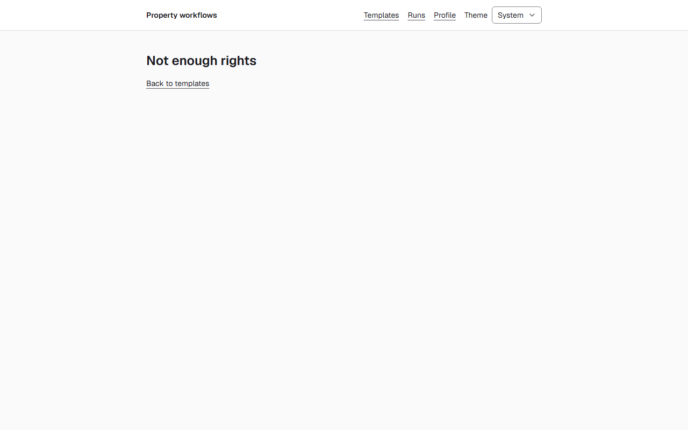
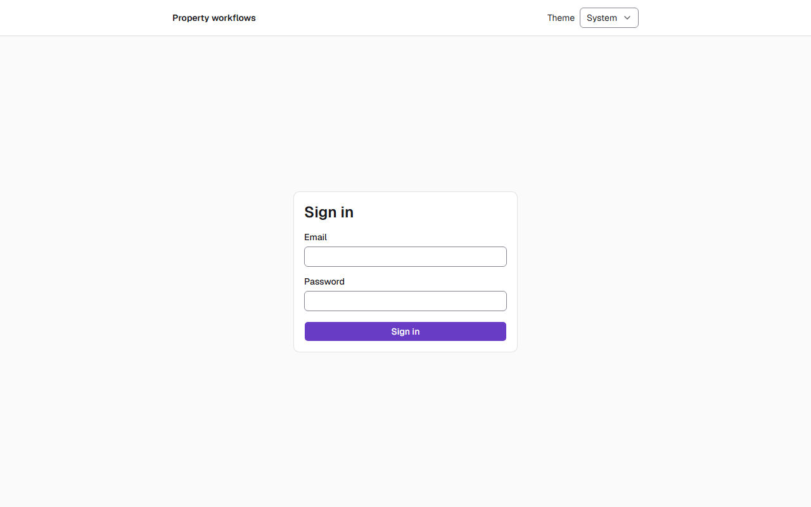
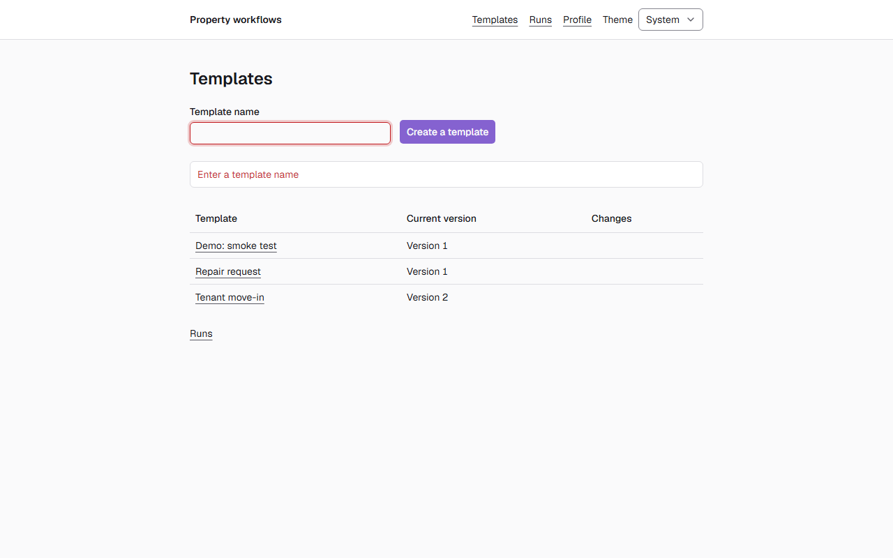

# Звіт UAT — 02.11.2026

- **Застосунок:** https://property-workflows-eta.vercel.app (/api/health: коміт `a2c2bcc`)
- **Код тестів:** `main` @ `a2c2bcc`
- **Прогін:** 02.11.2026, 17:54 (Київ), Playwright 38.1 с; AC: 3 — PASS 3, FAIL 0, NEEDS-HUMAN 0
- **Рецензент:** `claude-haiku-5-5`; суперечки → `claude-sonnet-5-5`. Разом за розбір: $0.0060 (ціни API; за підпискою — у межах ліміту плану)
- **Прибирання:** синтетичних uat-*@example.test видалено 0, лишилось 0, їхніх рядків, що лишились: 0
- **Відео й траси:** не в git — `test-results/` локально або артефакт CI; трасу відкриває `npx playwright show-trace <trace.zip>`

| AC | Перевірки | Агент | Підсумок | Чому | Playwright | Розбір |
|---|---|---|---|---|---|---|
| AC-EDITOR-07 | пройшли | Haiku: PASS | **PASS** | R6: перевірки, агент і цитати збігаються | 6.4 с | $0.0017, 8.4 с |
| AC-EDITOR-09 | пройшли | Haiku: PASS | **PASS** | R6: перевірки, агент і цитати збігаються | 2.2 с | $0.0020, 11.1 с |
| AC-EDITOR-19 | пройшли | Haiku: PASS | **PASS** | R6: перевірки, агент і цитати збігаються | 10.8 с | $0.0023, 12.3 с |

## AC-EDITOR-07 — PASS

**Тест:** AC-EDITOR-07: менеджер B за прямим посиланням на список версій бачить «Not enough rights» і жодної версії

**Критерій** (requirements/20-edit-a-template-with-version-control.md):

> AC-EDITOR-07: Given manager B signed in and the template "Tenant move-in" with versions 1 and 2. When B opens the list of versions of this template by a direct link. Then B sees the message "Not enough rights" and no versions.

**Кроки:** ✔ Дано: manager B signed in and the template "Tenant move-in" with versions 1 and 2 → ✔ Коли: B opens the list of versions of this template by a direct link → ✔ Тоді: B sees the message "Not enough rights" and no versions.

**Агент (claude-haiku-5-5, PASS):** На кадрі frame-then-1.png видно заголовок «Not enough rights» і посилання «Back to templates» під ним, текст збігається з критерієм посимвольно. Таблиці версій або рядків «Version N» на кадрі немає, але це з розділу «Не з кадрів», тому не оцінювалося.

**Цитати агента, звірені зі сторінкою (aria):**
- «Not enough rights» — є на сторінці
- «Back to templates» — є на сторінці

**Правило:** R6: перевірки, агент і цитати збігаються

**Відео:** `test-results/artifacts/template-versions-forbidde-2f920-ugh-rights»-і-жодної-версії-chromium/video.webm` · **траса:** `test-results/artifacts/template-versions-forbidde-2f920-ugh-rights»-і-жодної-версії-chromium/trace.zip` (не в git)

**Рішення PM:** ☐ приймаю · ☐ відхилення від вимог (issue «Відхилення від вимог: AC-EDITOR-07 — …») · @login: ____

## AC-EDITOR-09 — PASS

**Тест:** AC-EDITOR-09: відвідувач без входу за прямим посиланням на редактор бачить сторінку входу й жодного вмісту шаблону

**Критерій** (requirements/20-edit-a-template-with-version-control.md):

> AC-EDITOR-09: Given a visitor who is not signed in. When the visitor opens the editor of the template "Tenant move-in" by a direct link. Then the visitor sees the sign-in page and no content of the template.

**Кроки:** ✔ Дано: a visitor who is not signed in → ✔ Коли: the visitor opens the editor of the template "Tenant move-in" by a direct link → ✔ Тоді: the visitor sees the sign-in page and no content of the template.

**Агент (claude-haiku-5-5, PASS):** На кадрі frame-then-1.png видно сторінку входу з заголовком «Sign in», полями «Email» і «Password» та кнопкою «Sign in»; вмісту шаблону на кадрі немає. Видимі частини «Тоді» підтверджені дослівними цитатами, частини «Не з кадрів» не оцінювалися.

**Цитати агента, звірені зі сторінкою (aria):**
- «Sign in» — є на сторінці
- «Email» — є на сторінці
- «Password» — є на сторінці

**Правило:** R6: перевірки, агент і цитати збігаються

**Відео:** `test-results/artifacts/template-editor-signed-out-e4907-ду-й-жодного-вмісту-шаблону-chromium/video.webm` · **траса:** `test-results/artifacts/template-editor-signed-out-e4907-ду-й-жодного-вмісту-шаблону-chromium/trace.zip` (не в git)

**Рішення PM:** ☐ приймаю · ☐ відхилення від вимог (issue «Відхилення від вимог: AC-EDITOR-09 — …») · @login: ____

## AC-EDITOR-19 — PASS

**Тест:** AC-EDITOR-19: адміністратор створює шаблон з порожньою назвою чи лише з пробілів — шаблон не створено, «Enter a template name»

**Критерій** (requirements/20-edit-a-template-with-version-control.md):

> AC-EDITOR-19: Given administrator A. When A creates a new template with the name empty or consisting only of spaces. Then no template is created, and A sees the message "Enter a template name".

**Кроки:** ✔ Дано: administrator A → ✔ Коли: A creates a new template with the name empty → ✔ Тоді: no template is created, and A sees the message "Enter a template name". → ✔ Коли: A creates a new template with the name consisting only of spaces → ✔ Тоді: no template is created, and A sees the message "Enter a template name".

**Агент (claude-haiku-5-5, PASS):** На обох кадрах (сторінка /templates) під полем «Template name» і над таблицею шаблонів червоним текстом написано «Enter a template name», поле введення підсвічено червоною рамкою. Таблиця на обох кадрах показує ті самі три шаблони, що свідчить про відсутність нового запису, але це перевіряють автоматичні перевірки, а не кадри.

**Цитати агента, звірені зі сторінкою (aria):**
- «Enter a template name» — є на сторінці
- «Enter a template name» — є на сторінці

**Правило:** R6: перевірки, агент і цитати збігаються

**Відео:** `test-results/artifacts/template-name-required-AC--7c5fa-ено-«Enter-a-template-name»-chromium/video.webm` · **траса:** `test-results/artifacts/template-name-required-AC--7c5fa-ено-«Enter-a-template-name»-chromium/trace.zip` (не в git)

**Рішення PM:** ☐ приймаю · ☐ відхилення від вимог (issue «Відхилення від вимог: AC-EDITOR-19 — …») · @login: ____

## Як читати підсумок

- **PASS** — автоматичні перевірки пройшли, агент-рецензент погодився з кадром, а кожну його цитату знайдено на сторінці.
- **FAIL** — впала автоматична перевірка. Агент цього не перекриває: невидимі вади (буфер обміну, база) він на кадрі не побачить.
- **NEEDS-HUMAN** — перевірки зелені, але агент не погодився або його цитати немає на сторінці. Часто це слабкий тест або розбіжність між текстом AC і тестом — питання до PM, а не обов'язково вада продукту.

Правила: R1: перевірка впала — FAIL завжди, агент не перекриває; R2: немає вердикту агента або кадру; R3: перевірки пройшли, агент не погоджується — вирішує людина; R4: цитати агента немає на сторінці (aria) — не підтверджено; R5: помилка сторінки або 5xx під час сценарію; R6: перевірки, агент і цитати збігаються.
