# Звіт UAT — 09.11.2026

- **Застосунок:** https://property-workflows-eta.vercel.app (/api/health: коміт `5230d5e`)
- **Код тестів:** `main` @ `5230d5e`
- **Прогін:** 09.11.2026, 15:04 (Київ), Playwright 200.7 с; AC: 13 — PASS 13, FAIL 0, NEEDS-HUMAN 0
- **Рецензент:** `claude-haiku-5-5`; суперечки → `claude-sonnet-5-5`. Разом за розбір: $0.0277 (ціни API; за підпискою — у межах ліміту плану)
- **Прибирання:** синтетичних uat-*@example.test видалено 21, лишилось 0, їхніх рядків, що лишились: 0
- **Відео й траси:** не в git — `test-results/` локально або артефакт CI; трасу відкриває `npx playwright show-trace <trace.zip>`

| AC | Перевірки | Агент | Підсумок | Чому | Playwright | Розбір |
|---|---|---|---|---|---|---|
| AC-EDITOR-07 | пройшли | Haiku: PASS | **PASS** | R6: перевірки, агент і цитати збігаються | 5.1 с | $0.0023, 8.8 с |
| AC-EDITOR-09 | пройшли | Haiku: PASS | **PASS** | R6: перевірки, агент і цитати збігаються | 3.3 с | $0.0022, 8.5 с |
| AC-EDITOR-19 | пройшли | Haiku: PASS | **PASS** | R6: перевірки, агент і цитати збігаються | 11.9 с | $0.0027, 10.0 с |
| AC-VENDOR-01 | пройшли | Haiku: PASS | **PASS** | R6: перевірки, агент і цитати збігаються | 23.8 с | $0.0027, 15.3 с |
| AC-VENDOR-02 | пройшли | Haiku: PASS | **PASS** | R6: перевірки, агент і цитати збігаються | 18.7 с | $0.0023, 11.6 с |
| AC-VENDOR-03 | пройшли | Haiku: PASS | **PASS** | R6: перевірки, агент і цитати збігаються | 12.6 с | $0.0019, 7.9 с |
| AC-VENDOR-04 | пройшли | Haiku: PASS | **PASS** | R6: перевірки, агент і цитати збігаються | 16.3 с | $0.0020, 8.5 с |
| AC-VENDOR-05 | пройшли | Haiku: PASS | **PASS** | R6: перевірки, агент і цитати збігаються | 15.6 с | $0.0019, 7.7 с |
| AC-VENDOR-06 | пройшли | Haiku: PASS | **PASS** | R6: перевірки, агент і цитати збігаються | 13.0 с | $0.0017, 6.6 с |
| AC-VENDOR-07 | пройшли | Haiku: PASS | **PASS** | R6: перевірки, агент і цитати збігаються | 12.9 с | $0.0022, 9.9 с |
| AC-VENDOR-08 | пройшли | Haiku: PASS | **PASS** | R6: перевірки, агент і цитати збігаються | 10.2 с | $0.0018, 7.1 с |
| AC-VENDOR-09 | пройшли | Haiku: PASS | **PASS** | R6: перевірки, агент і цитати збігаються | 14.6 с | $0.0020, 9.5 с |
| AC-VENDOR-10 | пройшли | Haiku: PASS | **PASS** | R6: перевірки, агент і цитати збігаються | 10.7 с | $0.0019, 8.4 с |

## AC-EDITOR-07 — PASS

**Тест:** AC-EDITOR-07: менеджер B за прямим посиланням на список версій бачить «Not enough rights» і жодної версії

**Критерій** (requirements/20-edit-a-template-with-version-control.md):

> AC-EDITOR-07: Given manager B signed in and the template "Tenant move-in" with versions 1 and 2. When B opens the list of versions of this template by a direct link. Then B sees the message "Not enough rights" and no versions.

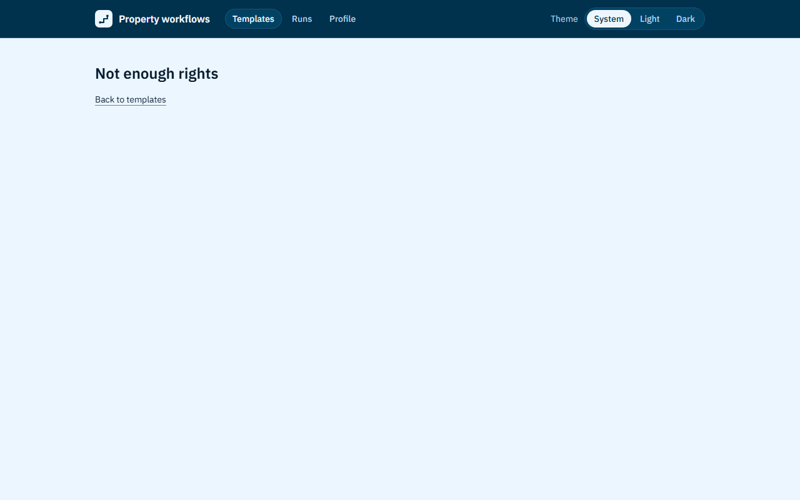

**Кроки:** ✔ Дано: manager B signed in and the template "Tenant move-in" with versions 1 and 2 → ✔ Коли: B opens the list of versions of this template by a direct link → ✔ Тоді: B sees the message "Not enough rights" and no versions.

**Агент (claude-haiku-5-5, PASS):** На кадрі frame-then-1.png видно заголовок «Not enough rights» і нижче посилання «Back to templates» на сторінці з шапкою «Property workflows». Обидві видимі частини «Тоді» збігаються з критерієм посимвольно; таблиці версій на кадрі немає.

**Цитати агента, звірені зі сторінкою (aria):**
- «Not enough rights» — є на сторінці
- «Back to templates» — є на сторінці

**Правило:** R6: перевірки, агент і цитати збігаються

**Відео:** `test-results/artifacts/template-versions-forbidde-2f920-ugh-rights»-і-жодної-версії-chromium/video.webm` · **траса:** `test-results/artifacts/template-versions-forbidde-2f920-ugh-rights»-і-жодної-версії-chromium/trace.zip` (не в git)

**Рішення PM:** ☐ приймаю · ☐ відхилення від вимог (issue «Відхилення від вимог: AC-EDITOR-07 — …») · @login: ____

## AC-EDITOR-09 — PASS

**Тест:** AC-EDITOR-09: відвідувач без входу за прямим посиланням на редактор бачить сторінку входу й жодного вмісту шаблону

**Критерій** (requirements/20-edit-a-template-with-version-control.md):

> AC-EDITOR-09: Given a visitor who is not signed in. When the visitor opens the editor of the template "Tenant move-in" by a direct link. Then the visitor sees the sign-in page and no content of the template.

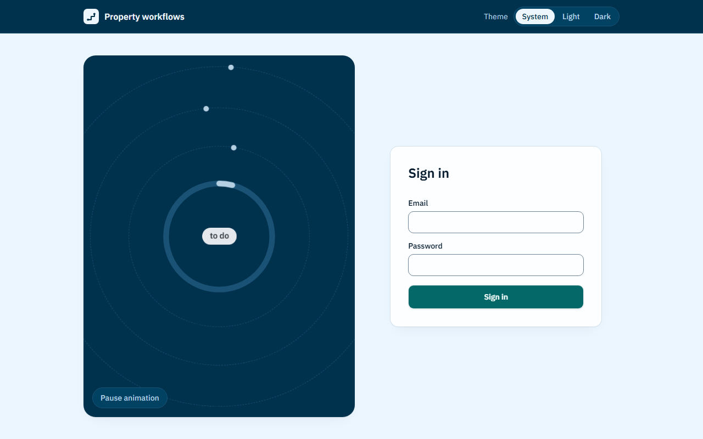

**Кроки:** ✔ Дано: a visitor who is not signed in → ✔ Коли: the visitor opens the editor of the template "Tenant move-in" by a direct link → ✔ Тоді: the visitor sees the sign-in page and no content of the template.

**Агент (claude-haiku-5-5, PASS):** На кадрі видно сторінку входу з заголовком «Sign in», полями «Email» і «Password» та кнопкою «Sign in». Жодного вмісту шаблону «Tenant move-in» на кадрі немає; це не з кадрів, тож я цього не оцінював. Текст «to do» на лівій анімованій панелі — декоративний елемент сторінки входу, не вміст шаблону.

**Цитати агента, звірені зі сторінкою (aria):**
- «Sign in» — є на сторінці
- «Email» — є на сторінці
- «Password» — є на сторінці

**Правило:** R6: перевірки, агент і цитати збігаються

**Відео:** `test-results/artifacts/template-editor-signed-out-e4907-ду-й-жодного-вмісту-шаблону-chromium/video.webm` · **траса:** `test-results/artifacts/template-editor-signed-out-e4907-ду-й-жодного-вмісту-шаблону-chromium/trace.zip` (не в git)

**Рішення PM:** ☐ приймаю · ☐ відхилення від вимог (issue «Відхилення від вимог: AC-EDITOR-09 — …») · @login: ____

## AC-EDITOR-19 — PASS

**Тест:** AC-EDITOR-19: адміністратор створює шаблон з порожньою назвою чи лише з пробілів — шаблон не створено, «Enter a template name»

**Критерій** (requirements/20-edit-a-template-with-version-control.md):

> AC-EDITOR-19: Given administrator A. When A creates a new template with the name empty or consisting only of spaces. Then no template is created, and A sees the message "Enter a template name".

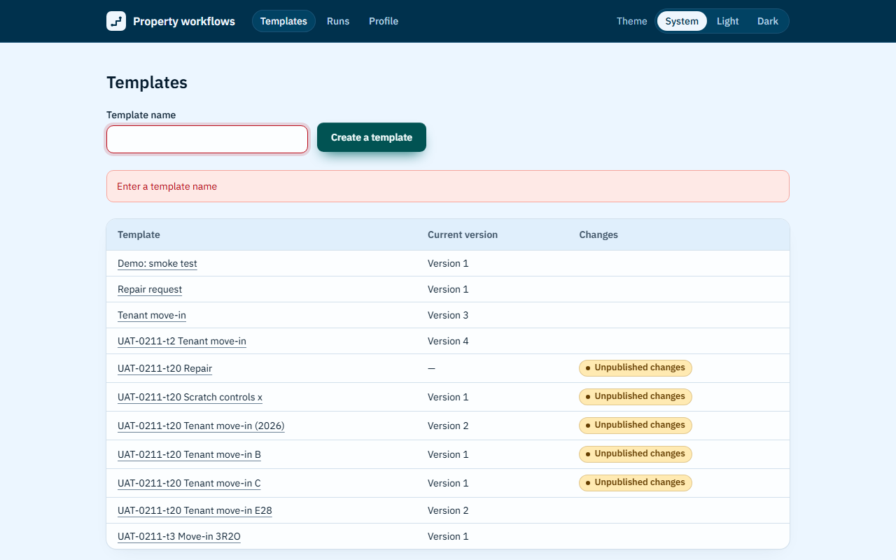

**Кроки:** ✔ Дано: administrator A → ✔ Коли: A creates a new template with the name empty → ✔ Тоді: no template is created, and A sees the message "Enter a template name". → ✔ Коли: A creates a new template with the name consisting only of spaces → ✔ Тоді: no template is created, and A sees the message "Enter a template name".

**Агент (claude-haiku-5-5, PASS):** На обох кадрах (сторінка /templates, поле «Template name» порожнє з червоною рамкою) над таблицею шаблонів видно червоний банер із текстом «Enter a template name», що збігається з критерієм посимвольно. Частини про відсутність нового шаблону та про пробіли не з кадрів, тому не оцінюються.

**Цитати агента, звірені зі сторінкою (aria):**
- «Enter a template name» — є на сторінці
- «Enter a template name» — є на сторінці

**Правило:** R6: перевірки, агент і цитати збігаються

**Відео:** `test-results/artifacts/template-name-required-AC--7c5fa-ено-«Enter-a-template-name»-chromium/video.webm` · **траса:** `test-results/artifacts/template-name-required-AC--7c5fa-ено-«Enter-a-template-name»-chromium/trace.zip` (не в git)

**Рішення PM:** ☐ приймаю · ☐ відхилення від вимог (issue «Відхилення від вимог: AC-EDITOR-19 — …») · @login: ____

## AC-VENDOR-01 — PASS

**Тест:** AC-VENDOR-01: менеджер A запускає «Tenant move-in» для «Apartment 12, move-in» і призначає вендора V на задачі 3 і 4 — вони за V, а задачі 1, 2 і 5 за A

**Критерій** (requirements/39-assign-a-vendor.md):

> AC-VENDOR-01: Given manager A, vendor V and the template "Tenant move-in" with 5 tasks. When A launches the template for the case "Apartment 12, move-in" and assigns V as the assignee of tasks 3 and 4. Then tasks 3 and 4 have V as the assignee, and tasks 1, 2 and 5 have A.

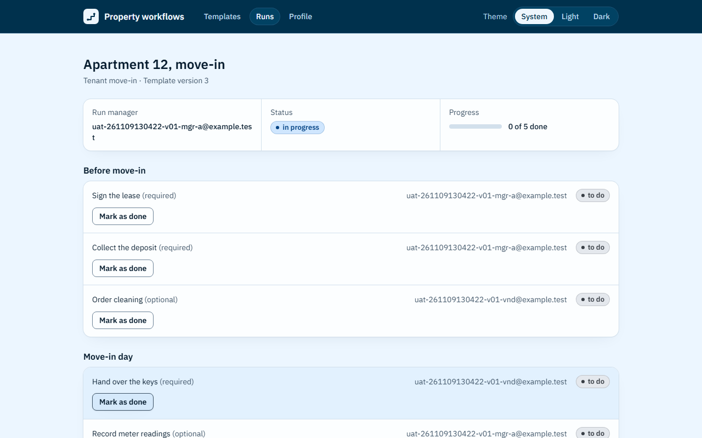

**Кроки:** ✔ Дано: manager A, vendor V and the template "Tenant move-in" with 5 tasks → ✔ Коли: A launches the template for the case "Apartment 12, move-in" and assigns V as the assignee of tasks 3 and 4 → ✔ Тоді: tasks 3 and 4 have V as the assignee, and tasks 1, 2 and 5 have A.

**Агент (claude-haiku-5-5, PASS):** На кадрі видно сторінку запуску з назвою «Apartment 12, move-in», де задачі 3 і 4 мають виконавця uat-261109130422-v01-vnd@example.test, а задачі 1, 2 і 5 мають uat-261109130422-v01-mgr-a@example.test (Run manager — той самий mgr-a). Задача 5 («Record meter readings») стоїть у самому низу кадру, але її назва і email виконавця читаються повністю; статус-мітка обрізана, хоча вона не є частиною «Тоді».

**Цитати агента, звірені зі сторінкою (aria):**
- «Apartment 12, move-in» — є на сторінці
- «Order cleaning (optional) uat-261109130422-v01-vnd@example.test» — є на сторінці
- «Hand over the keys (required) uat-261109130422-v01-vnd@example.test» — є на сторінці
- «Sign the lease (required) uat-261109130422-v01-mgr-a@example.test» — є на сторінці
- «Collect the deposit (required) uat-261109130422-v01-mgr-a@example.test» — є на сторінці
- «Record meter readings (optional) uat-261109130422-v01-mgr-a@example.test» — є на сторінці

**Правило:** R6: перевірки, агент і цитати збігаються

**Відео:** `test-results/artifacts/vendor-assign-AC-VENDOR-01-f0642--за-V-а-задачі-1-2-і-5-за-A-chromium/video.webm` · **траса:** `test-results/artifacts/vendor-assign-AC-VENDOR-01-f0642--за-V-а-задачі-1-2-і-5-за-A-chromium/trace.zip` (не в git)

**Рішення PM:** ☐ приймаю · ☐ відхилення від вимог (issue «Відхилення від вимог: AC-VENDOR-01 — …») · @login: ____

## AC-VENDOR-02 — PASS

**Тест:** AC-VENDOR-02: у виборі виконавця менеджер A бачить email менеджера B, адміністратора й вендора V — і жодних імен, ролей чи інших даних профілю

**Критерій** (requirements/39-assign-a-vendor.md):

> AC-VENDOR-02: Given managers A and B, an administrator and vendor V, and A launching a template. When A opens the assignee picker. Then A sees the emails of B, of the administrator and of V, and no names, roles or other profile data.

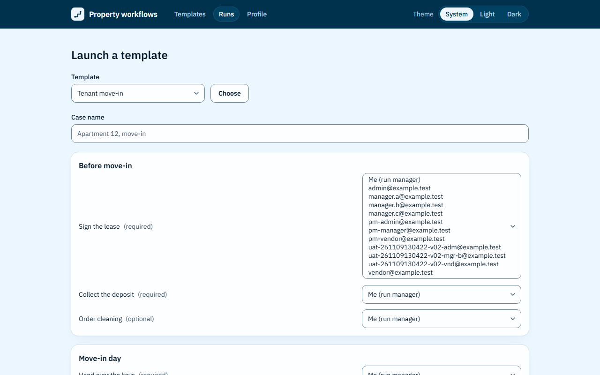

**Кроки:** ✔ Дано: managers A and B, an administrator and vendor V, and A launching a template → ✔ Коли: A opens the assignee picker → ✔ Тоді: A sees the emails of B, of the administrator and of V, and no names, roles or other profile data.

**Агент (claude-haiku-5-5, PASS):** На кадрі frame-then-1.png відкритий список виконавця для задачі «Sign the lease (required)» із пунктами «Me (run manager)» та низкою email-адрес, зокрема uat-261109130422-v02-mgr-b@example.test, uat-261109130422-v02-adm@example.test і uat-261109130422-v02-vnd@example.test. Усі три видимі частини «Тоді» підтверджено дослівними цитатами; що саме є B, адміністратором і V, з кадру напряму не видно, а лише з самих адрес (mgr-b, adm, vnd). Список також містить інші адреси (admin@, manager.a@, pm-*@, vendor@ тощо), які не входять до критерію і не впливають на вердикт; перевірку «без імен і ролей» не оцінював за правилами.

**Цитати агента, звірені зі сторінкою (aria):**
- «uat-261109130422-v02-mgr-b@example.test» — є на сторінці
- «uat-261109130422-v02-adm@example.test» — є на сторінці
- «uat-261109130422-v02-vnd@example.test» — є на сторінці

**Правило:** R6: перевірки, агент і цитати збігаються

**Відео:** `test-results/artifacts/vendor-assign-AC-VENDOR-02-6a9c2-олей-чи-інших-даних-профілю-chromium/video.webm` · **траса:** `test-results/artifacts/vendor-assign-AC-VENDOR-02-6a9c2-олей-чи-інших-даних-профілю-chromium/trace.zip` (не в git)

**Рішення PM:** ☐ приймаю · ☐ відхилення від вимог (issue «Відхилення від вимог: AC-VENDOR-02 — …») · @login: ____

## AC-VENDOR-03 — PASS

**Тест:** AC-VENDOR-03: вендор V із двома задачами в «Apartment 12, move-in» і без задач в «Apartment 14, repair» бачить у списку лише перший запуск, його статус і «Your tasks: 0 of 2 done»

**Критерій** (requirements/39-assign-a-vendor.md):

> AC-VENDOR-03: Given vendor V who is the assignee of 2 tasks in the run "Apartment 12, move-in" and of no task in the run "Apartment 14, repair". When V opens the list of runs. Then V sees only the run "Apartment 12, move-in" with its run status and "Your tasks: 0 of 2 done", and does not see "Apartment 14, repair".

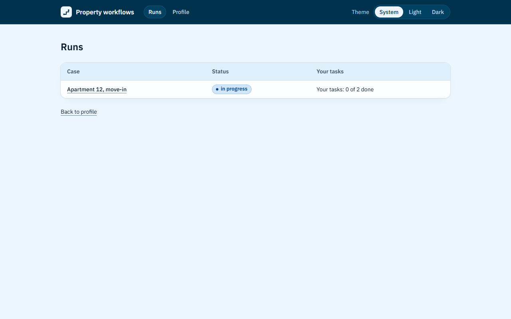

**Кроки:** ✔ Дано: vendor V who is the assignee of 2 tasks in the run "Apartment 12, move-in" and of no task in the run "Apartment 14, repair" → ✔ Коли: V opens the list of runs → ✔ Тоді: V sees only the run "Apartment 12, move-in" with its run status and "Your tasks: 0 of 2 done", and does not see "Apartment 14, repair".

**Агент (claude-haiku-5-5, PASS):** На кадрі /runs у таблиці є лише один рядок даних: «Apartment 12, move-in» зі статусом «in progress» і написом «Your tasks: 0 of 2 done». Рядка «Apartment 14, repair» на кадрі немає, але це перевіряють автоматичні перевірки, тому я його не оцінював.

**Цитати агента, звірені зі сторінкою (aria):**
- «Apartment 12, move-in» — є на сторінці
- «in progress» — є на сторінці
- «Your tasks: 0 of 2 done» — є на сторінці

**Правило:** R6: перевірки, агент і цитати збігаються

**Відео:** `test-results/artifacts/vendor-runs-AC-VENDOR-03-в-597b4--і-«Your-tasks-0-of-2-done»-chromium/video.webm` · **траса:** `test-results/artifacts/vendor-runs-AC-VENDOR-03-в-597b4--і-«Your-tasks-0-of-2-done»-chromium/trace.zip` (не в git)

**Рішення PM:** ☐ приймаю · ☐ відхилення від вимог (issue «Відхилення від вимог: AC-VENDOR-03 — …») · @login: ____

## AC-VENDOR-04 — PASS

**Тест:** AC-VENDOR-04: вендор V відкриває «Apartment 12, move-in» (5 задач) і бачить рівно задачі 3 і 4 — назва, розділ, «required» чи «optional» і статус, без чужих задач, email інших користувачів і прогресу всього запуску

**Критерій** (requirements/39-assign-a-vendor.md):

> AC-VENDOR-04: Given vendor V who is the assignee of tasks 3 and 4 in the run "Apartment 12, move-in" (5 tasks). When V opens this run. Then V sees exactly tasks 3 and 4, each with its name, its section, the mark "required" or "optional" and its status, and does not see tasks 1, 2 and 5, the emails of other users or the progress of the whole run.

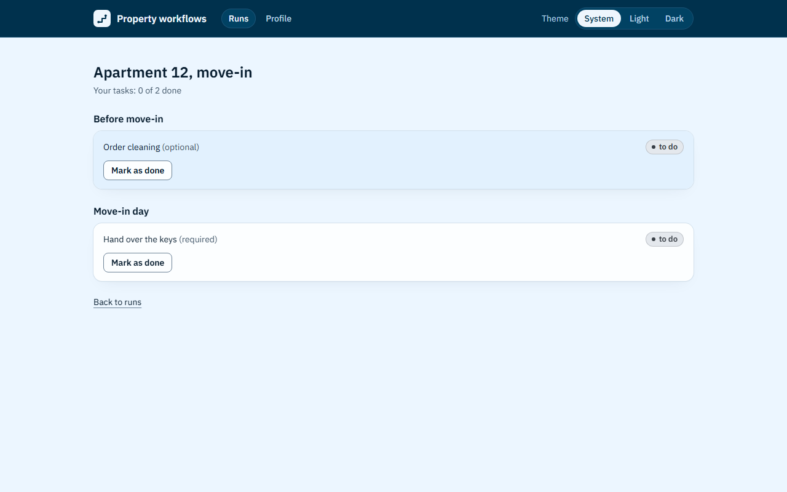

**Кроки:** ✔ Дано: vendor V who is the assignee of tasks 3 and 4 in the run "Apartment 12, move-in" (5 tasks) → ✔ Коли: V opens this run → ✔ Тоді: V sees exactly tasks 3 and 4, each with its name, its section, the mark "required" or "optional" and its status, and does not see tasks 1, 2 and 5, the emails of other users or the progress of the whole run.

**Агент (claude-haiku-5-5, PASS):** На кадрі видно сторінку «Apartment 12, move-in» з лічильником «Your tasks: 0 of 2 done» (лише задачі V, без прогресу всього запуску) і двома картками: «Order cleaning (optional)» у розділі «Before move-in» та «Hand over the keys (required)» у розділі «Move-in day», обидві зі статусом «to do». Кадр повний, читабельний, без завантаження; відсутність задач 1, 2, 5 і чужих email на кадрі не оцінювалася, бо це частина «Не з кадрів».

**Цитати агента, звірені зі сторінкою (aria):**
- «Your tasks: 0 of 2 done» — є на сторінці
- «Before move-in» — є на сторінці
- «Order cleaning (optional)» — є на сторінці
- «to do» — є на сторінці
- «Move-in day» — є на сторінці
- «Hand over the keys (required)» — є на сторінці
- «to do» — є на сторінці

**Правило:** R6: перевірки, агент і цитати збігаються

**Відео:** `test-results/artifacts/vendor-runs-AC-VENDOR-04-в-9b0aa-в-і-прогресу-всього-запуску-chromium/video.webm` · **траса:** `test-results/artifacts/vendor-runs-AC-VENDOR-04-в-9b0aa-в-і-прогресу-всього-запуску-chromium/trace.zip` (не в git)

**Рішення PM:** ☐ приймаю · ☐ відхилення від вимог (issue «Відхилення від вимог: AC-VENDOR-04 — …») · @login: ____

## AC-VENDOR-05 — PASS

**Тест:** AC-VENDOR-05: вендор V позначає виконаною свою задачу 3 (не остання обов'язкова) — вона «done», а V бачить «Your tasks: 1 of 2 done»

**Критерій** (requirements/39-assign-a-vendor.md):

> AC-VENDOR-05: Given vendor V who is the assignee of task 3 with status "to do", which is not the last required task of the run "Apartment 12, move-in". When V marks task 3 as done. Then task 3 has status "done", and V sees "Your tasks: 1 of 2 done".

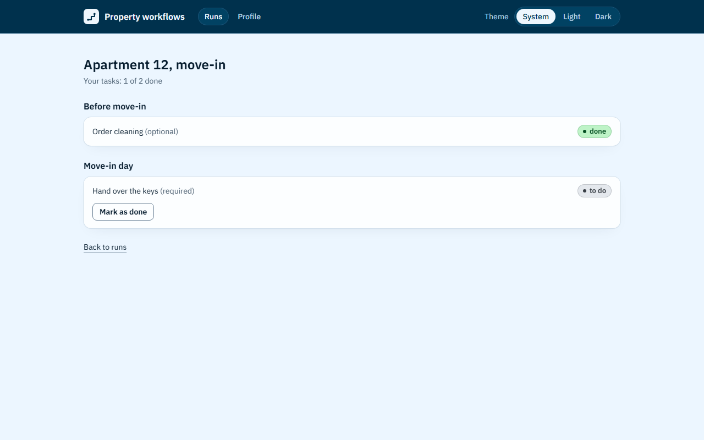

**Кроки:** ✔ Дано: vendor V who is the assignee of task 3 with status "to do", which is not the last required task of the run "Apartment 12, move-in" → ✔ Коли: V marks task 3 as done → ✔ Тоді: task 3 has status "done", and V sees "Your tasks: 1 of 2 done".

**Агент (claude-haiku-5-5, PASS):** На кадрі сторінки «Apartment 12, move-in» задача «Order cleaning (optional)» має бейдж «done», а під заголовком написано «Your tasks: 1 of 2 done». Обидві видимі частини «Тоді» збігаються з критерієм посимвольно. Суфікс «(optional)» у назві задачі в критерії не згаданий, але він не суперечить умові «не остання обов'язкова».

**Цитати агента, звірені зі сторінкою (aria):**
- «Order cleaning (optional)» — є на сторінці
- «done» — є на сторінці
- «Your tasks: 1 of 2 done» — є на сторінці

**Правило:** R6: перевірки, агент і цитати збігаються

**Відео:** `test-results/artifacts/vendor-runs-AC-VENDOR-05-в-e392a-ть-«Your-tasks-1-of-2-done»-chromium/video.webm` · **траса:** `test-results/artifacts/vendor-runs-AC-VENDOR-05-в-e392a-ть-«Your-tasks-1-of-2-done»-chromium/trace.zip` (не в git)

**Рішення PM:** ☐ приймаю · ☐ відхилення від вимог (issue «Відхилення від вимог: AC-VENDOR-05 — …») · @login: ____

## AC-VENDOR-06 — PASS

**Тест:** AC-VENDOR-06: вендор V за прямим посиланням на «Apartment 14, repair», де в нього немає задач, бачить «Run not found» і жодної задачі запуску

**Критерій** (requirements/39-assign-a-vendor.md):

> AC-VENDOR-06: Given the run "Apartment 14, repair" in which vendor V has no task. When V opens the page of this run by a direct link. Then V sees the message "Run not found" and none of the tasks of the run.

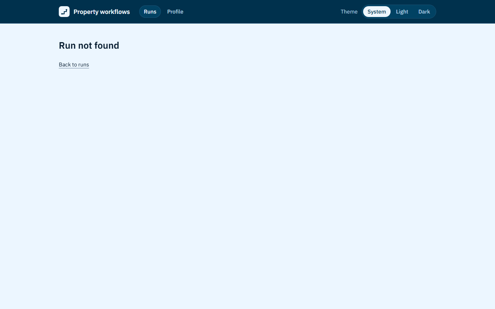

**Кроки:** ✔ Дано: the run "Apartment 14, repair" in which vendor V has no task → ✔ Коли: V opens the page of this run by a direct link → ✔ Тоді: V sees the message "Run not found" and none of the tasks of the run.

**Агент (claude-haiku-5-5, PASS):** На кадрі frame-then-1.png видно великий заголовок «Run not found» і нижче посилання «Back to runs» на сторінці без жодних задач чи назви запуску. Обидві видимі частини «Тоді» збігаються з критерієм посимвольно. Частини про відсутність задач і прямий URL не оцінювались, бо за правилами вони не з кадрів.

**Цитати агента, звірені зі сторінкою (aria):**
- «Run not found» — є на сторінці
- «Back to runs» — є на сторінці

**Правило:** R6: перевірки, агент і цитати збігаються

**Відео:** `test-results/artifacts/vendor-runs-AC-VENDOR-06-в-f3fdf-nd»-і-жодної-задачі-запуску-chromium/video.webm` · **траса:** `test-results/artifacts/vendor-runs-AC-VENDOR-06-в-f3fdf-nd»-і-жодної-задачі-запуску-chromium/trace.zip` (не в git)

**Рішення PM:** ☐ приймаю · ☐ відхилення від вимог (issue «Відхилення від вимог: AC-VENDOR-06 — …») · @login: ____

## AC-VENDOR-07 — PASS

**Тест:** AC-VENDOR-07: вендор V прямим запитом, в обхід сторінок, позначає задачу 1 менеджера A — відмова, задача 1 лишається «to do»

**Критерій** (requirements/39-assign-a-vendor.md):

> AC-VENDOR-07: Given the run "Apartment 12, move-in" in which task 1 is assigned to manager A and tasks 3 and 4 to vendor V. When V tries to mark task 1 as done directly, bypassing the pages of the application. Then task 1 stays "to do".

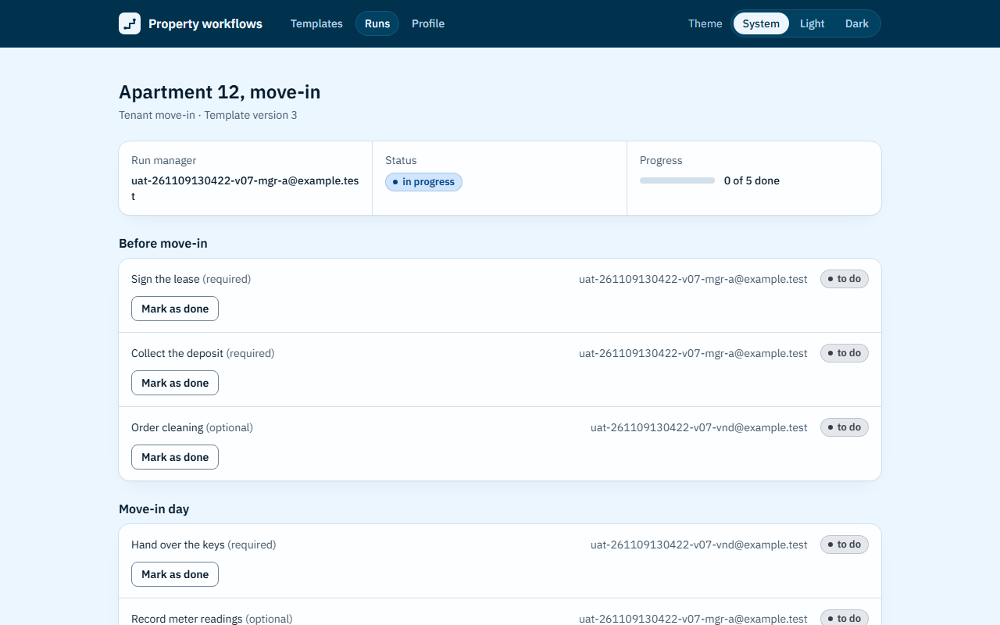

**Кроки:** ✔ Дано: the run "Apartment 12, move-in" in which task 1 is assigned to manager A and tasks 3 and 4 to vendor V → ✔ Коли: V tries to mark task 1 as done directly, bypassing the pages of the application → ✔ Тоді: task 1 stays "to do".

**Агент (claude-haiku-5-5, PASS):** На кадрі сторінка запуску «Apartment 12, move-in» з Run manager uat-261109130422-v07-mgr-a@example.test. Перша задача «Sign the lease (required)» має бейдж «to do», а блок Progress показує «0 of 5 done». Обидві видимі частини «Тоді» підтверджені дослівним текстом кадру.

**Цитати агента, звірені зі сторінкою (aria):**
- «Sign the lease (required)» — є на сторінці
- «to do» — є на сторінці
- «0 of 5 done» — є на сторінці

**Правило:** R6: перевірки, агент і цитати збігаються

**Відео:** `test-results/artifacts/vendor-forbidden-AC-VENDOR-21bdc--задача-1-лишається-«to-do»-chromium/video.webm` · **траса:** `test-results/artifacts/vendor-forbidden-AC-VENDOR-21bdc--задача-1-лишається-«to-do»-chromium/trace.zip` (не в git)

**Рішення PM:** ☐ приймаю · ☐ відхилення від вимог (issue «Відхилення від вимог: AC-VENDOR-07 — …») · @login: ____

## AC-VENDOR-08 — PASS

**Тест:** AC-VENDOR-08: вендор V за прямим посиланням на список шаблонів бачить «Not enough rights» і жодного шаблону

**Критерій** (requirements/39-assign-a-vendor.md):

> AC-VENDOR-08: Given vendor V signed in. When V opens the list of templates by a direct link. Then V sees the message "Not enough rights" and no template.

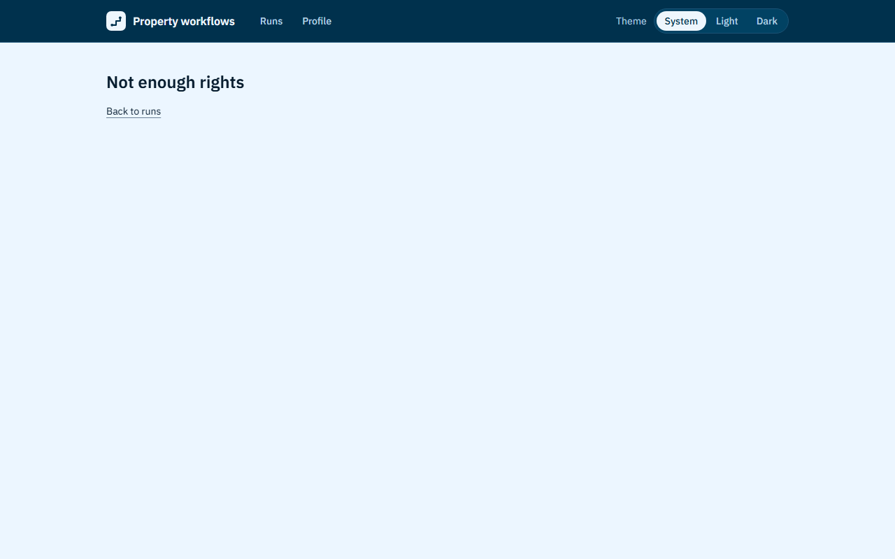

**Кроки:** ✔ Дано: vendor V signed in → ✔ Коли: V opens the list of templates by a direct link → ✔ Тоді: V sees the message "Not enough rights" and no template.

**Агент (claude-haiku-5-5, PASS):** На кадрі frame-then-1.png видно заголовок «Not enough rights» і посилання «Back to runs» під ним, без жодного шаблону чи таблиці. Обидві видимі частини «Тоді» збігаються з критерієм посимвольно. Адресний рядок на кадрі не видно, тому факт, що адреса лишилась на сторінці зі списком шаблонів, цією перевіркою не оцінювався.

**Цитати агента, звірені зі сторінкою (aria):**
- «Not enough rights» — є на сторінці
- «Back to runs» — є на сторінці

**Правило:** R6: перевірки, агент і цитати збігаються

**Відео:** `test-results/artifacts/vendor-forbidden-AC-VENDOR-8ec7a-h-rights»-і-жодного-шаблону-chromium/video.webm` · **траса:** `test-results/artifacts/vendor-forbidden-AC-VENDOR-8ec7a-h-rights»-і-жодного-шаблону-chromium/trace.zip` (не в git)

**Рішення PM:** ☐ приймаю · ☐ відхилення від вимог (issue «Відхилення від вимог: AC-VENDOR-08 — …») · @login: ____

## AC-VENDOR-09 — PASS

**Тест:** AC-VENDOR-09: вендор V прямим запитом, в обхід сторінок, запускає «Tenant move-in» — запуск не створено, список запусків не змінився

**Критерій** (requirements/39-assign-a-vendor.md):

> AC-VENDOR-09: Given vendor V signed in and the template "Tenant move-in" with current version 1. When V tries to launch this template directly, bypassing the pages of the application. Then no run is created, and the list of runs does not change.

**Кроки:** ✔ Дано: vendor V signed in and the template "Tenant move-in" with a current version → ✔ Коли: V tries to launch this template directly, bypassing the pages of the application → ✔ Тоді: no run is created, and the list of runs does not change.

**Агент (claude-haiku-5-5, PASS):** На кадрі /runs у таблиці видно лише один рядок «Apartment 12, move-in» зі статусом «in progress» і «Your tasks: 0 of 2 done»; рядка «Apartment 16, move-in» немає. Кадру «до» немає, тож порівняння «той самий список» спирається на те, що зараз у списку один запис, а не на зіставлення зі станом до спроби.

**Цитати агента, звірені зі сторінкою (aria):**
- «Apartment 12, move-in» — є на сторінці
- «Your tasks: 0 of 2 done» — є на сторінці
- «Apartment 12, move-in» — є на сторінці

**Правило:** R6: перевірки, агент і цитати збігаються

**Відео:** `test-results/artifacts/vendor-forbidden-AC-VENDOR-01f35-список-запусків-не-змінився-chromium/video.webm` · **траса:** `test-results/artifacts/vendor-forbidden-AC-VENDOR-01f35-список-запусків-не-змінився-chromium/trace.zip` (не в git)

**Рішення PM:** ☐ приймаю · ☐ відхилення від вимог (issue «Відхилення від вимог: AC-VENDOR-09 — …») · @login: ____

## AC-VENDOR-10 — PASS

**Тест:** AC-VENDOR-10: вендор V, якому не призначено жодної задачі, відкриває список запусків і бачить «No tasks assigned to you yet.» без порожньої таблиці

**Критерій** (requirements/39-assign-a-vendor.md):

> AC-VENDOR-10: Given vendor V to whom no task is assigned. When V opens the list of runs. Then V sees the message "No tasks assigned to you yet." and no empty table.

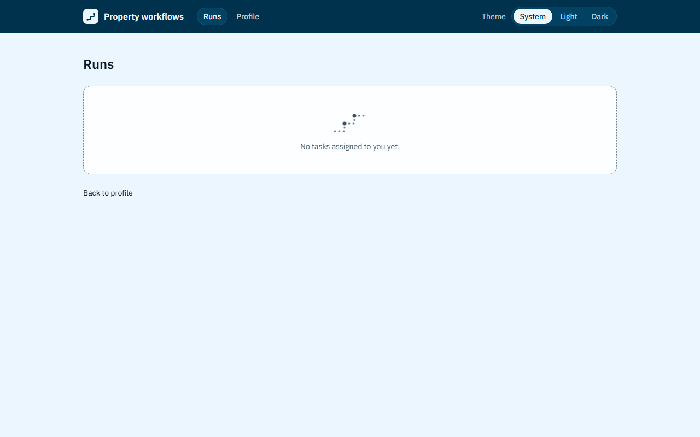

**Кроки:** ✔ Дано: vendor V to whom no task is assigned → ✔ Коли: V opens the list of runs → ✔ Тоді: V sees the message "No tasks assigned to you yet." and no empty table.

**Агент (claude-haiku-5-5, PASS):** На кадрі /runs (заголовок «Runs») видно текст «No tasks assigned to you yet.» у порожньому блоці з пунктирною рамкою, символ у символ як у критерії. Частини «Не з кадрів» (відсутність таблиці, чужий запуск «Apartment 14, repair») не оцінював.

**Цитати агента, звірені зі сторінкою (aria):**
- «No tasks assigned to you yet.» — є на сторінці

**Правило:** R6: перевірки, агент і цитати збігаються

**Відео:** `test-results/artifacts/vendor-runs-AC-VENDOR-10-в-75084-yet-»-без-порожньої-таблиці-chromium/video.webm` · **траса:** `test-results/artifacts/vendor-runs-AC-VENDOR-10-в-75084-yet-»-без-порожньої-таблиці-chromium/trace.zip` (не в git)

**Рішення PM:** ☐ приймаю · ☐ відхилення від вимог (issue «Відхилення від вимог: AC-VENDOR-10 — …») · @login: ____

## Як читати підсумок

- **PASS** — автоматичні перевірки пройшли, агент-рецензент погодився з кадром, а кожну його цитату знайдено на сторінці.
- **FAIL** — впала автоматична перевірка. Агент цього не перекриває: невидимі вади (буфер обміну, база) він на кадрі не побачить.
- **NEEDS-HUMAN** — перевірки зелені, але агент не погодився або його цитати немає на сторінці. Часто це слабкий тест або розбіжність між текстом AC і тестом — питання до PM, а не обов'язково вада продукту.

Правила: R1: перевірка впала — FAIL завжди, агент не перекриває; R2: немає вердикту агента або кадру; R3: перевірки пройшли, агент не погоджується — вирішує людина; R4: цитати агента немає на сторінці (aria) — не підтверджено; R5: помилка сторінки або 5xx під час сценарію; R6: перевірки, агент і цитати збігаються.
