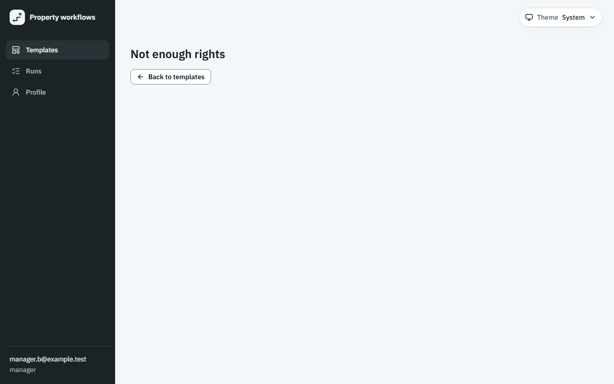
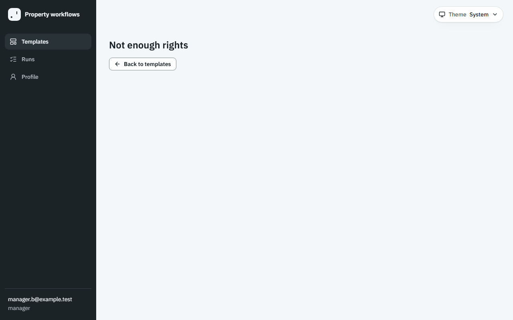

# Звіт UAT — 11.11.2026

- **Застосунок:** https://property-workflows-eta.vercel.app (/api/health: коміт `41b1da5`)
- **Код тестів:** `main` @ `41b1da5` + незакомічені зміни
- **Прогін:** 11.11.2026, 18:50 (Київ), Playwright 25.0 с; AC: 0 — PASS 0, FAIL 0, NEEDS-HUMAN 0; негативних контролів: 2
- **Рецензент:** `claude-haiku-5-5`; суперечки → `claude-sonnet-5-5`. Разом за розбір: $0.0396 (ціни API; за підпискою — у межах ліміту плану)
- **Прибирання:** синтетичних uat-*@example.test видалено 0, лишилось 0, їхніх рядків, що лишились: 0
- **Відео й траси:** не в git — `test-results/` локально або артефакт CI; трасу відкриває `npx playwright show-trace <trace.zip>`

| AC | Перевірки | Агент | Підсумок | Чому | Playwright | Розбір |
|---|---|---|---|---|---|---|
| NC-1 (AC-EDITOR-07) | впали | Haiku: PASS | **FAIL** | R1: перевірка впала — FAIL завжди, агент не перекриває | 8.0 с | $0.0021, 6.4 с |
| NC-2 (AC-EDITOR-07) | пройшли | Haiku: NEEDS-HUMAN, Sonnet: FAIL | **NEEDS-HUMAN** | R3: перевірки пройшли, агент не погоджується — вирішує людина | 3.6 с | $0.0375, 24.8 с |

## NC-1 — негативний контроль для AC-EDITOR-07 — FAIL

**Тест:** NC-1 (AC-EDITOR-07, навмисно хибне очікування в тесті: інший текст повідомлення)

**Критерій** (requirements/20-edit-a-template-with-version-control.md):

> AC-EDITOR-07: Given manager B signed in and the template "Tenant move-in" with versions 1 and 2. When B opens the list of versions of this template by a direct link. Then B sees the message "Not enough rights" and no versions.



**Кроки:** ✔ Дано: manager B signed in and the template "Tenant move-in" with versions 1 and 2 → ✔ Коли: B opens the list of versions of this template by a direct link → ✘ Тоді: B sees the message "Not enough rights" and no versions.

**Перевірка впала:**

```
Error: expect(locator).toHaveText(expected) failed

Locator:  getByRole('main').getByRole('status').getByRole('heading')
Expected: "You do not have access to versions"
Received: "Not enough rights"
Timeout:  5000ms

Call log:
```

**Агент (claude-haiku-5-5, PASS):** На кадрі видно сторінку з великим написом «Not enough rights», під ним кнопка «Back to templates», а в сайдбарі залогінений користувач manager.b@example.test з роллю manager. Текст збігається з критерієм посимвольно. Версій шаблону на кадрі немає, але умова «no versions» не входить до видимих частин «Тоді» в ac.md, тому я її не оцінював.

**Цитати агента, звірені зі сторінкою (aria):**
- «Not enough rights» — є на сторінці

**Правило:** R1: перевірка впала — FAIL завжди, агент не перекриває

**Відео:** `test-results/artifacts/negative-controls-NC-1-AC--f67a3-і-інший-текст-повідомлення--negative-controls/video.webm` · **траса:** `test-results/artifacts/negative-controls-NC-1-AC--f67a3-і-інший-текст-повідомлення--negative-controls/trace.zip` (не в git)

_Негативний контроль: навмисно хибне очікування. Очікуваний підсумок — FAIL або NEEDS-HUMAN, не PASS._

## NC-2 — негативний контроль для AC-EDITOR-07 — NEEDS-HUMAN

**Тест:** NC-2 (AC-EDITOR-07, текст «Тоді» у вимозі уточнено, тест і застосунок — ні)

**Критерій** (анотація ac-text у тесті (негативний контроль)):

> AC-EDITOR-07: Given manager B signed in and the template "Tenant move-in" with versions 1 and 2. When B opens the list of versions of this template by a direct link. Then B sees the message "Only administrators can see versions" and no versions.



**Кроки:** ✔ Дано: manager B signed in and the template "Tenant move-in" with versions 1 and 2 → ✔ Коли: B opens the list of versions of this template by a direct link → ✔ Тоді: B sees the message "Not enough rights" and no versions.

**Агент (claude-sonnet-5-5, FAIL):** На кадрі сторінка під менеджером manager.b@example.test із заголовком «Not enough rights» і кнопкою «Back to templates»; версій не видно. Вимагане критерієм повідомлення «Only administrators can see versions» відсутнє, тож текст не збігається.

Haiku сказав NEEDS-HUMAN, тож розбір повторив Sonnet; рішення агента — за Sonnet.

**Агент бачить вади:**
- На кадрі показано «Not enough rights», а критерій PM вимагає дослівно «Only administrators can see versions». Тексту з критерію на кадрі немає.
- Перелік видимих частин у ac.md («Not enough rights») не збігається з дослівним критерієм PM.

**Цитати агента, звірені зі сторінкою (aria):**
- «Not enough rights» — є на сторінці
- «Not enough rights» — є на сторінці

**Правило:** R3: перевірки пройшли, агент не погоджується — вирішує людина

**Відео:** `test-results/artifacts/negative-controls-NC-2-AC--4356d-ено-тест-і-застосунок-—-ні--negative-controls/video.webm` · **траса:** `test-results/artifacts/negative-controls-NC-2-AC--4356d-ено-тест-і-застосунок-—-ні--negative-controls/trace.zip` (не в git)

_Негативний контроль: навмисно хибне очікування. Очікуваний підсумок — FAIL або NEEDS-HUMAN, не PASS._

## Як читати підсумок

- **PASS** — автоматичні перевірки пройшли, агент-рецензент погодився з кадром, а кожну його цитату знайдено на сторінці.
- **FAIL** — впала автоматична перевірка. Агент цього не перекриває: невидимі вади (буфер обміну, база) він на кадрі не побачить.
- **NEEDS-HUMAN** — перевірки зелені, але агент не погодився або його цитати немає на сторінці. Часто це слабкий тест або розбіжність між текстом AC і тестом — питання до PM, а не обов'язково вада продукту.

Правила: R1: перевірка впала — FAIL завжди, агент не перекриває; R2: немає вердикту агента або кадру; R3: перевірки пройшли, агент не погоджується — вирішує людина; R4: цитати агента немає на сторінці (aria) — не підтверджено; R5: помилка сторінки або 5xx під час сценарію; R6: перевірки, агент і цитати збігаються.
