# Звіт UAT — 15.11.2026

- **Застосунок:** https://property-workflows-eta.vercel.app (/api/health: коміт `2a2e6c8`)
- **Код тестів:** `task/feedback-uat-evidence` @ `8e01350`
- **Прогін:** 15.11.2026, 14:16 (Київ), Playwright 317.6 с; AC: 22 — PASS 22, FAIL 0, NEEDS-HUMAN 0
- **Рецензент:** `claude-haiku-5-5`; суперечки → `claude-sonnet-5-5`. Разом за розбір: $0.1481 (ціни API; за підпискою — у межах ліміту плану)
- **Прибирання:** синтетичних uat-*@example.test видалено 41, лишилось 0, їхніх рядків, що лишились: 0
- **Відео й траси:** не в git — `test-results/` локально або артефакт CI; трасу відкриває `npx playwright show-trace <trace.zip>`

| AC | Перевірки | Агент | Підсумок | Чому | Playwright | Розбір |
|---|---|---|---|---|---|---|
| AC-EDITOR-07 | пройшли | Haiku: PASS | **PASS** | R6: перевірки, агент і цитати збігаються | 5.2 с | $0.0020, 7.9 с |
| AC-EDITOR-09 | пройшли | Haiku: PASS | **PASS** | R6: перевірки, агент і цитати збігаються | 2.1 с | $0.0020, 8.1 с |
| AC-EDITOR-19 | пройшли | Haiku: PASS | **PASS** | R6: перевірки, агент і цитати збігаються | 11.7 с | $0.0027, 10.3 с |
| AC-TASK-19 | пройшли | Haiku: PASS | **PASS** | R6: перевірки, агент і цитати збігаються | 17.1 с | $0.0024, 10.5 с |
| AC-VENDOR-01 | пройшли | Haiku: NEEDS-HUMAN, Sonnet: PASS | **PASS** | R6: перевірки, агент і цитати збігаються | 20.0 с | $0.0384, 27.6 с |
| AC-VENDOR-02 | пройшли | Haiku: PASS | **PASS** | R6: перевірки, агент і цитати збігаються | 16.4 с | $0.0022, 9.2 с |
| AC-VENDOR-03 | пройшли | Haiku: PASS | **PASS** | R6: перевірки, агент і цитати збігаються | 11.7 с | $0.0021, 7.4 с |
| AC-VENDOR-04 | пройшли | Haiku: PASS | **PASS** | R6: перевірки, агент і цитати збігаються | 16.6 с | $0.0022, 8.6 с |
| AC-VENDOR-05 | пройшли | Haiku: PASS | **PASS** | R6: перевірки, агент і цитати збігаються | 13.3 с | $0.0022, 9.3 с |
| AC-VENDOR-06 | пройшли | Haiku: PASS | **PASS** | R6: перевірки, агент і цитати збігаються | 11.7 с | $0.0022, 9.1 с |
| AC-VENDOR-07 | пройшли | Haiku: PASS | **PASS** | R6: перевірки, агент і цитати збігаються | 14.6 с | $0.0025, 10.6 с |
| AC-VENDOR-08 | пройшли | Haiku: PASS | **PASS** | R6: перевірки, агент і цитати збігаються | 8.3 с | $0.0024, 8.8 с |
| AC-VENDOR-09 | пройшли | Haiku: PASS | **PASS** | R6: перевірки, агент і цитати збігаються | 15.0 с | $0.0028, 13.8 с |
| AC-VENDOR-10 | пройшли | Haiku: NEEDS-HUMAN, Sonnet: PASS | **PASS** | R6: перевірки, агент і цитати збігаються | 10.7 с | $0.0314, 17.4 с |
| AC-VENDOR-11 | пройшли | Haiku: PASS | **PASS** | R6: перевірки, агент і цитати збігаються | 12.3 с | $0.0024, 7.9 с |
| AC-VENDOR-12 | пройшли | Haiku: PASS | **PASS** | R6: перевірки, агент і цитати збігаються | 14.8 с | $0.0020, 8.0 с |
| AC-VENDOR-13 | пройшли | Haiku: PASS | **PASS** | R6: перевірки, агент і цитати збігаються | 7.2 с | $0.0021, 7.1 с |
| AC-VENDOR-14 | пройшли | Haiku: PASS | **PASS** | R6: перевірки, агент і цитати збігаються | 16.3 с | $0.0036, 10.7 с |
| AC-VENDOR-15 | пройшли | Haiku: NEEDS-HUMAN, Sonnet: PASS | **PASS** | R6: перевірки, агент і цитати збігаються | 15.1 с | $0.0319, 17.5 с |
| AC-VENDOR-16 | пройшли | Haiku: PASS | **PASS** | R6: перевірки, агент і цитати збігаються | 18.3 с | $0.0028, 10.3 с |
| AC-VENDOR-17 | пройшли | Haiku: PASS | **PASS** | R6: перевірки, агент і цитати збігаються | 11.9 с | $0.0024, 9.2 с |
| AC-VENDOR-18 | пройшли | Haiku: PASS | **PASS** | R6: перевірки, агент і цитати збігаються | 16.6 с | $0.0034, 12.3 с |

## AC-EDITOR-07 — PASS

**Тест:** AC-EDITOR-07: менеджер B за прямим посиланням на список версій бачить «Not enough rights» і жодної версії

**Критерій** (requirements/20-edit-a-template-with-version-control.md):

> AC-EDITOR-07: Given manager B signed in and the template "Tenant move-in" with versions 1 and 2. When B opens the list of versions of this template by a direct link. Then B sees the message "Not enough rights" and no versions.

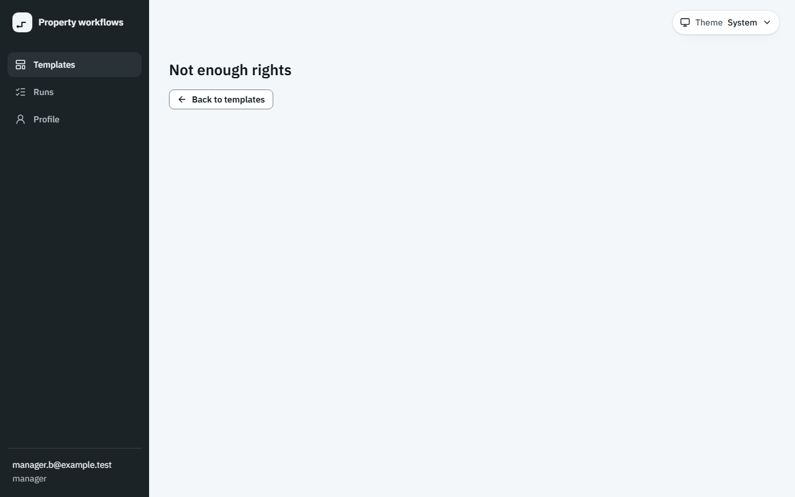

**Кроки:** ✔ Дано: manager B signed in and the template "Tenant move-in" with versions 1 and 2 → ✔ Коли: B opens the list of versions of this template by a direct link → ✔ Тоді: B sees the message "Not enough rights" and no versions.

**Агент (claude-haiku-5-5, PASS):** На кадрі frame-then-1.png видно великий заголовок «Not enough rights» і кнопку «Back to templates» з іконкою стрілки; таблиці версій і рядків «Version N» на екрані немає. Обидві видимі частини «Тоді» підтверджені дослівними цитатами. Частини про відсутність версій і про те, що адреса лишилась на сторінці списку, не з кадрів, тож їх не оцінювано.

**Цитати агента, звірені зі сторінкою (aria):**
- «Not enough rights» — є на сторінці
- «Back to templates» — є на сторінці

**Правило:** R6: перевірки, агент і цитати збігаються

**Відео:** `test-results/artifacts/template-versions-forbidde-2f920-ugh-rights»-і-жодної-версії-chromium/video.webm` · **траса:** `test-results/artifacts/template-versions-forbidde-2f920-ugh-rights»-і-жодної-версії-chromium/trace.zip` (не в git)

**Рішення PM:** ☐ приймаю · ☐ відхилення від вимог (issue «Відхилення від вимог: AC-EDITOR-07 — …») · @login: ____

## AC-EDITOR-09 — PASS

**Тест:** AC-EDITOR-09: відвідувач без входу за прямим посиланням на редактор бачить сторінку входу й жодного вмісту шаблону

**Критерій** (requirements/20-edit-a-template-with-version-control.md):

> AC-EDITOR-09: Given a visitor who is not signed in. When the visitor opens the editor of the template "Tenant move-in" by a direct link. Then the visitor sees the sign-in page and no content of the template.

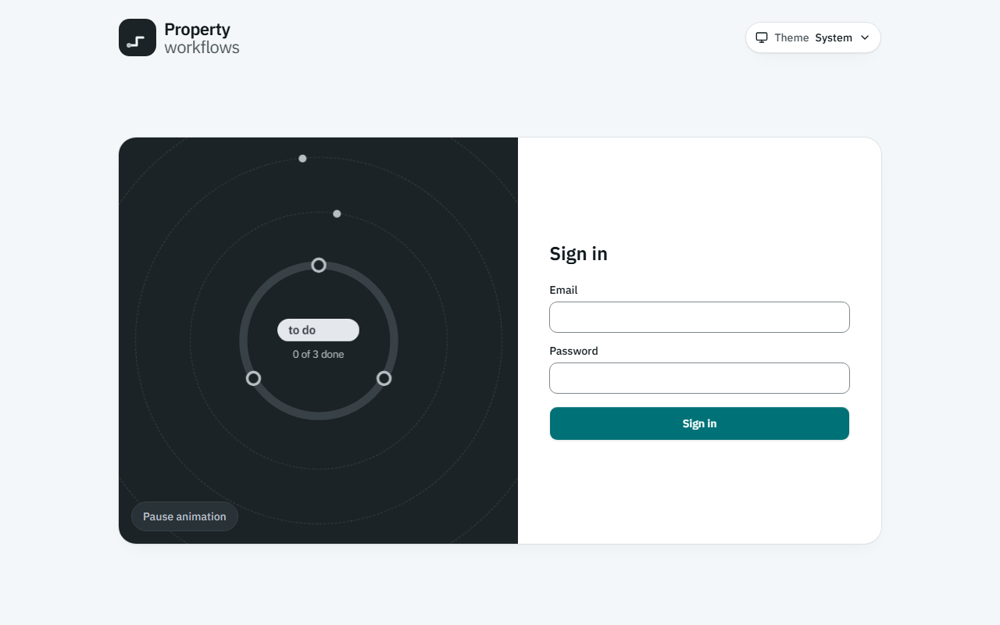

**Кроки:** ✔ Дано: a visitor who is not signed in → ✔ Коли: the visitor opens the editor of the template "Tenant move-in" by a direct link → ✔ Тоді: the visitor sees the sign-in page and no content of the template.

**Агент (claude-haiku-5-5, PASS):** На кадрі frame-then-1.png видно сторінку входу з заголовком «Sign in», полями «Email» і «Password» та кнопкою «Sign in». Вмісту шаблону «Tenant move-in» на кадрі не видно. Адресу /login і відсутність вмісту шаблону в тексті кадру не перевіряв, бо це не з кадрів.

**Цитати агента, звірені зі сторінкою (aria):**
- «Sign in» — є на сторінці
- «Email» — є на сторінці
- «Password» — є на сторінці

**Правило:** R6: перевірки, агент і цитати збігаються

**Відео:** `test-results/artifacts/template-editor-signed-out-e4907-ду-й-жодного-вмісту-шаблону-chromium/video.webm` · **траса:** `test-results/artifacts/template-editor-signed-out-e4907-ду-й-жодного-вмісту-шаблону-chromium/trace.zip` (не в git)

**Рішення PM:** ☐ приймаю · ☐ відхилення від вимог (issue «Відхилення від вимог: AC-EDITOR-09 — …») · @login: ____

## AC-EDITOR-19 — PASS

**Тест:** AC-EDITOR-19: адміністратор створює шаблон з порожньою назвою чи лише з пробілів — шаблон не створено, «Enter a template name»

**Критерій** (requirements/20-edit-a-template-with-version-control.md):

> AC-EDITOR-19: Given administrator A. When A creates a new template with the name empty or consisting only of spaces. Then no template is created, and A sees the message "Enter a template name".

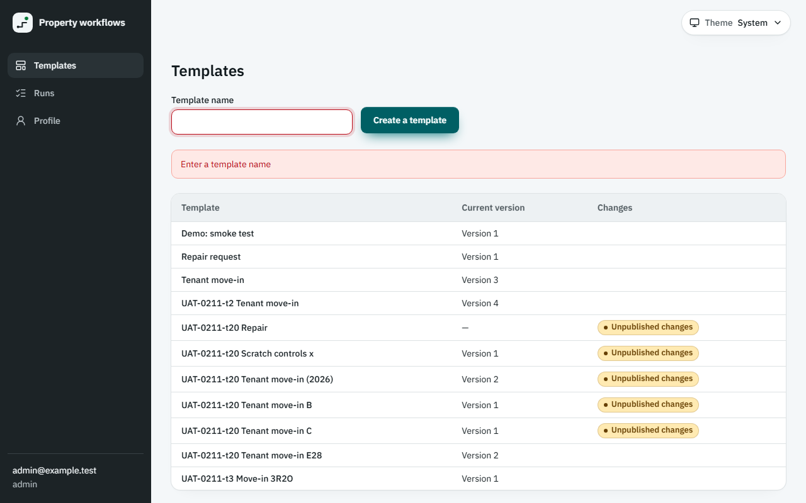

**Кроки:** ✔ Дано: administrator A → ✔ Коли: A creates a new template with the name empty → ✔ Тоді: no template is created, and A sees the message "Enter a template name". → ✔ Коли: A creates a new template with the name consisting only of spaces → ✔ Тоді: no template is created, and A sees the message "Enter a template name".

**Агент (claude-haiku-5-5, PASS):** На обох кадрах (frame-then-1.png і frame-then-2.png) над списком шаблонів під полем «Template name» видно червоний напис «Enter a template name», який збігається з критерієм посимвольно. Поле введення виділене червоною рамкою, список шаблонів під повідомленням відображається. Частини про кількість рядків і назву з пробілів не з кадрів, тому не оцінювалися.

**Цитати агента, звірені зі сторінкою (aria):**
- «Enter a template name» — є на сторінці
- «Enter a template name» — є на сторінці

**Правило:** R6: перевірки, агент і цитати збігаються

**Відео:** `test-results/artifacts/template-name-required-AC--7c5fa-ено-«Enter-a-template-name»-chromium/video.webm` · **траса:** `test-results/artifacts/template-name-required-AC--7c5fa-ено-«Enter-a-template-name»-chromium/trace.zip` (не в git)

**Рішення PM:** ☐ приймаю · ☐ відхилення від вимог (issue «Відхилення від вимог: AC-EDITOR-19 — …») · @login: ____

## AC-TASK-19 — PASS

**Тест:** AC-TASK-19: виконавець позначає необов'язкову задачу «to do» запуску «completed» — задача «done», запуск лишається «completed», прогрес її рахує

**Критерій** (requirements/3-complete-tasks-and-track-run-progress.md):

> AC-TASK-19: Given a run with status "completed" that has the optional task "Order a part" with status "to do", and the assignee of this task. When the assignee marks "Order a part" as done. Then the task has status "done", the run stays "completed", and the progress counts the task as done.

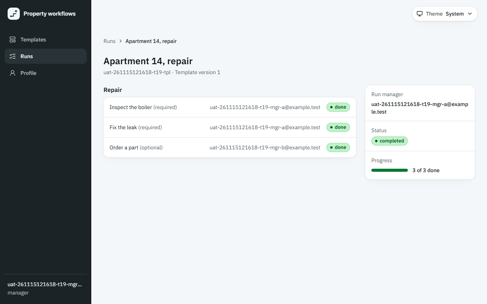

**Кроки:** ✔ Дано: a run with status "completed" that has the optional task "Order a part" with status "to do", and the assignee of this task → ✔ Коли: the assignee marks "Order a part" as done → ✔ Тоді: the task has status "done", the run stays "completed", and the progress counts the task as done.

**Агент (claude-haiku-5-5, PASS):** На кадрі frame-then-1.png у рядку «Order a part (optional)» видно бейдж «done», статус запуску — «completed», а прогрес — «3 of 3 done» з повною смугою. Кадр чіткий, обрізання немає, текст читається; перевірка збігається з трьома видимими частинами «Тоді». Стан у базі не з кадрів і не оцінювався.

**Цитати агента, звірені зі сторінкою (aria):**
- «Order a part (optional)» — є на сторінці
- «done» — є на сторінці
- «Status» — є на сторінці
- «completed» — є на сторінці
- «3 of 3 done» — є на сторінці

**Правило:** R6: перевірки, агент і цитати збігаються

**Відео:** `test-results/artifacts/optional-after-completed-A-0a10c-completed»-прогрес-її-рахує-chromium/video.webm` · **траса:** `test-results/artifacts/optional-after-completed-A-0a10c-completed»-прогрес-її-рахує-chromium/trace.zip` (не в git)

**Рішення PM:** ☐ приймаю · ☐ відхилення від вимог (issue «Відхилення від вимог: AC-TASK-19 — …») · @login: ____

## AC-VENDOR-01 — PASS

**Тест:** AC-VENDOR-01: менеджер A запускає «Tenant move-in» для «Apartment 12, move-in» і призначає вендора V на задачі 3 і 4 — вони за V, а задачі 1, 2 і 5 за A

**Критерій** (requirements/39-assign-a-vendor.md):

> AC-VENDOR-01: Given manager A, vendor V and the template "Tenant move-in" with 5 tasks. When A launches the template for the case "Apartment 12, move-in" and assigns V as the assignee of tasks 3 and 4. Then tasks 3 and 4 have V as the assignee, and tasks 1, 2 and 5 have A.

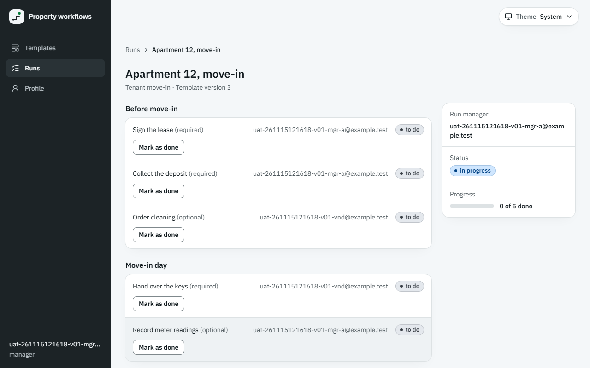

**Кроки:** ✔ Дано: manager A, vendor V and the template "Tenant move-in" with 5 tasks → ✔ Коли: A launches the template for the case "Apartment 12, move-in" and assigns V as the assignee of tasks 3 and 4 → ✔ Тоді: tasks 3 and 4 have V as the assignee, and tasks 1, 2 and 5 have A.

**Агент (claude-sonnet-5-5, PASS):** На сторінці запуску «Apartment 12, move-in» задачі «Order cleaning» і «Hand over the keys» мають виконавця ...-vnd@example.test, а решта трьох задач (Sign the lease, Collect the deposit, Record meter readings) — ...-mgr-a@example.test. Email-и відповідають ролям V (vnd) і A (mgr-a, він же Run manager).

Haiku сказав NEEDS-HUMAN, тож розбір повторив Sonnet; рішення агента — за Sonnet.

**Цитати агента, звірені зі сторінкою (aria):**
- «Apartment 12, move-in» — є на сторінці
- «Order cleaning (optional) uat-261115121618-v01-vnd@example.test» — є на сторінці
- «Hand over the keys (required) uat-261115121618-v01-vnd@example.test» — є на сторінці
- «Sign the lease (required) uat-261115121618-v01-mgr-a@example.test» — є на сторінці
- «Collect the deposit (required) uat-261115121618-v01-mgr-a@example.test» — є на сторінці
- «Record meter readings (optional) uat-261115121618-v01-mgr-a@example.test» — є на сторінці

**Правило:** R6: перевірки, агент і цитати збігаються

**Відео:** `test-results/artifacts/vendor-assign-AC-VENDOR-01-f0642--за-V-а-задачі-1-2-і-5-за-A-chromium/video.webm` · **траса:** `test-results/artifacts/vendor-assign-AC-VENDOR-01-f0642--за-V-а-задачі-1-2-і-5-за-A-chromium/trace.zip` (не в git)

**Рішення PM:** ☐ приймаю · ☐ відхилення від вимог (issue «Відхилення від вимог: AC-VENDOR-01 — …») · @login: ____

## AC-VENDOR-02 — PASS

**Тест:** AC-VENDOR-02: у виборі виконавця менеджер A бачить email менеджера B, адміністратора й вендора V — і жодних імен, ролей чи інших даних профілю

**Критерій** (requirements/39-assign-a-vendor.md):

> AC-VENDOR-02: Given managers A and B, an administrator and vendor V, and A launching a template. When A opens the assignee picker. Then A sees the emails of B, of the administrator and of V, and no names, roles or other profile data.

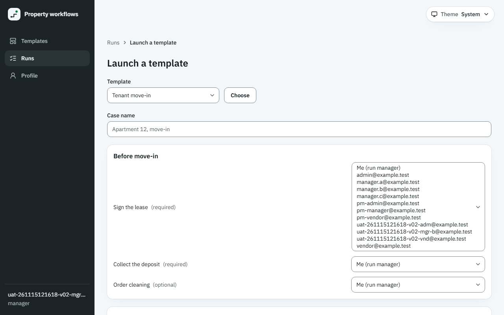

**Кроки:** ✔ Дано: managers A and B, an administrator and vendor V, and A launching a template → ✔ Коли: A opens the assignee picker → ✔ Тоді: A sees the emails of B, of the administrator and of V, and no names, roles or other profile data.

**Агент (claude-haiku-5-5, PASS):** На кадрі відкритий список виконавця для задачі «Sign the lease» (required). У ньому видно email адміністратора, менеджера B і вендора V, кожен окремим рядком, без імен і ролей. Списки для «Collect the deposit» і «Order cleaning» на кадрі згорнуті, тож їх вміст із кадру не видно; вердикт стосується відкритого списку, який бачить A.

**Цитати агента, звірені зі сторінкою (aria):**
- «uat-261115121618-v02-mgr-b@example.test» — є на сторінці
- «uat-261115121618-v02-adm@example.test» — є на сторінці
- «uat-261115121618-v02-vnd@example.test» — є на сторінці

**Правило:** R6: перевірки, агент і цитати збігаються

**Відео:** `test-results/artifacts/vendor-assign-AC-VENDOR-02-6a9c2-олей-чи-інших-даних-профілю-chromium/video.webm` · **траса:** `test-results/artifacts/vendor-assign-AC-VENDOR-02-6a9c2-олей-чи-інших-даних-профілю-chromium/trace.zip` (не в git)

**Рішення PM:** ☐ приймаю · ☐ відхилення від вимог (issue «Відхилення від вимог: AC-VENDOR-02 — …») · @login: ____

## AC-VENDOR-03 — PASS

**Тест:** AC-VENDOR-03: вендор V із двома задачами в «Apartment 12, move-in» і без задач в «Apartment 14, repair» бачить у списку лише перший запуск, його статус і «Your tasks: 0 of 2 done»

**Критерій** (requirements/39-assign-a-vendor.md):

> AC-VENDOR-03: Given vendor V who is the assignee of 2 tasks in the run "Apartment 12, move-in" and of no task in the run "Apartment 14, repair". When V opens the list of runs. Then V sees only the run "Apartment 12, move-in" with its run status and "Your tasks: 0 of 2 done", and does not see "Apartment 14, repair".

**Кроки:** ✔ Дано: vendor V who is the assignee of 2 tasks in the run "Apartment 12, move-in" and of no task in the run "Apartment 14, repair" → ✔ Коли: V opens the list of runs → ✔ Тоді: V sees only the run "Apartment 12, move-in" with its run status and "Your tasks: 0 of 2 done", and does not see "Apartment 14, repair".

**Агент (claude-haiku-5-5, PASS):** На кадрі сторінка «Runs» із таблицею з одним рядком: «Apartment 12, move-in», статус «in progress» і «Your tasks: 0 of 2 done». Рядка «Apartment 14, repair» на кадрі не видно, але це перевіряють автоматичні перевірки, тому я його не оцінював.

**Цитати агента, звірені зі сторінкою (aria):**
- «Apartment 12, move-in» — є на сторінці
- «in progress» — є на сторінці
- «Your tasks: 0 of 2 done» — є на сторінці

**Правило:** R6: перевірки, агент і цитати збігаються

**Відео:** `test-results/artifacts/vendor-runs-AC-VENDOR-03-в-597b4--і-«Your-tasks-0-of-2-done»-chromium/video.webm` · **траса:** `test-results/artifacts/vendor-runs-AC-VENDOR-03-в-597b4--і-«Your-tasks-0-of-2-done»-chromium/trace.zip` (не в git)

**Рішення PM:** ☐ приймаю · ☐ відхилення від вимог (issue «Відхилення від вимог: AC-VENDOR-03 — …») · @login: ____

## AC-VENDOR-04 — PASS

**Тест:** AC-VENDOR-04: вендор V відкриває «Apartment 12, move-in» (5 задач) і бачить рівно задачі 3 і 4 — назва, розділ, «required» чи «optional» і статус, без чужих задач, email інших користувачів і прогресу всього запуску

**Критерій** (requirements/39-assign-a-vendor.md):

> AC-VENDOR-04: Given vendor V who is the assignee of tasks 3 and 4 in the run "Apartment 12, move-in" (5 tasks). When V opens this run. Then V sees exactly tasks 3 and 4, each with its name, its section, the mark "required" or "optional" and its status, and does not see tasks 1, 2 and 5, the emails of other users or the progress of the whole run.

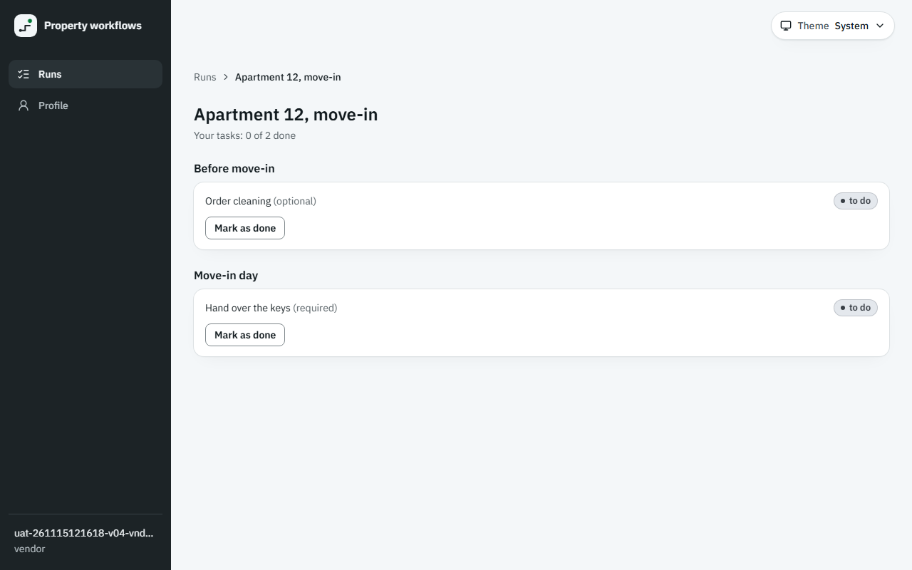

**Кроки:** ✔ Дано: vendor V who is the assignee of tasks 3 and 4 in the run "Apartment 12, move-in" (5 tasks) → ✔ Коли: V opens this run → ✔ Тоді: V sees exactly tasks 3 and 4, each with its name, its section, the mark "required" or "optional" and its status, and does not see tasks 1, 2 and 5, the emails of other users or the progress of the whole run.

**Агент (claude-haiku-5-5, PASS):** На кадрі видно сторінку «Apartment 12, move-in» з двома задачами: «Order cleaning (optional)» у розділі «Before move-in» і «Hand over the keys (required)» у розділі «Move-in day», обидві зі статусом «to do». Задач 1, 2, 5, email і прогрес всього запуску на кадрі немає; рядок «Your tasks: 0 of 2 done» стосується лише задач V. Пункти «Не з кадрів» не оцінювалися.

**Цитати агента, звірені зі сторінкою (aria):**
- «Order cleaning (optional)» — є на сторінці
- «Hand over the keys (required)» — є на сторінці
- «Before move-in» — є на сторінці
- «Order cleaning (optional)» — є на сторінці
- «to do» — є на сторінці
- «Move-in day» — є на сторінці
- «Hand over the keys (required)» — є на сторінці
- «to do» — є на сторінці

**Правило:** R6: перевірки, агент і цитати збігаються

**Відео:** `test-results/artifacts/vendor-runs-AC-VENDOR-04-в-9b0aa-в-і-прогресу-всього-запуску-chromium/video.webm` · **траса:** `test-results/artifacts/vendor-runs-AC-VENDOR-04-в-9b0aa-в-і-прогресу-всього-запуску-chromium/trace.zip` (не в git)

**Рішення PM:** ☐ приймаю · ☐ відхилення від вимог (issue «Відхилення від вимог: AC-VENDOR-04 — …») · @login: ____

## AC-VENDOR-05 — PASS

**Тест:** AC-VENDOR-05: вендор V позначає виконаною свою задачу 3 (не остання обов'язкова) — вона «done», а V бачить «Your tasks: 1 of 2 done»

**Критерій** (requirements/39-assign-a-vendor.md):

> AC-VENDOR-05: Given vendor V who is the assignee of task 3 with status "to do", which is not the last required task of the run "Apartment 12, move-in". When V marks task 3 as done. Then task 3 has status "done", and V sees "Your tasks: 1 of 2 done".

**Кроки:** ✔ Дано: vendor V who is the assignee of task 3 with status "to do", which is not the last required task of the run "Apartment 12, move-in" → ✔ Коли: V marks task 3 as done → ✔ Тоді: task 3 has status "done", and V sees "Your tasks: 1 of 2 done".

**Агент (claude-haiku-5-5, PASS):** На кадрі сторінка запуску «Apartment 12, move-in» з написом «Your tasks: 1 of 2 done» і з блоком «Order cleaning (optional)» зі статусом «done». Номер задачі 3 на кадрі не видно, тож відповідність задачі 3 перевірено лише за назвою «Order cleaning». Задача «Hand over the keys (required)» показана як «to do», що відповідає не-«Не з кадрів» частинам критерію і не суперечить йому.

**Цитати агента, звірені зі сторінкою (aria):**
- «Order cleaning (optional)» — є на сторінці
- «done» — є на сторінці
- «Your tasks: 1 of 2 done» — є на сторінці

**Правило:** R6: перевірки, агент і цитати збігаються

**Відео:** `test-results/artifacts/vendor-runs-AC-VENDOR-05-в-e392a-ть-«Your-tasks-1-of-2-done»-chromium/video.webm` · **траса:** `test-results/artifacts/vendor-runs-AC-VENDOR-05-в-e392a-ть-«Your-tasks-1-of-2-done»-chromium/trace.zip` (не в git)

**Рішення PM:** ☐ приймаю · ☐ відхилення від вимог (issue «Відхилення від вимог: AC-VENDOR-05 — …») · @login: ____

## AC-VENDOR-06 — PASS

**Тест:** AC-VENDOR-06: вендор V за прямим посиланням на «Apartment 14, repair», де в нього немає задач, бачить «Run not found» і жодної задачі запуску

**Критерій** (requirements/39-assign-a-vendor.md):

> AC-VENDOR-06: Given the run "Apartment 14, repair" in which vendor V has no task. When V opens the page of this run by a direct link. Then V sees the message "Run not found" and none of the tasks of the run.

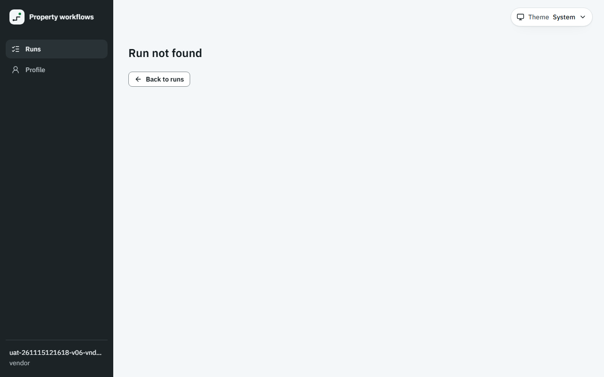

**Кроки:** ✔ Дано: the run "Apartment 14, repair" in which vendor V has no task → ✔ Коли: V opens the page of this run by a direct link → ✔ Тоді: V sees the message "Run not found" and none of the tasks of the run.

**Агент (claude-haiku-5-5, PASS):** На кадрі frame-then-1.png сторінка показує великий заголовок «Run not found» і кнопку «Back to runs» з лівою стрілкою; задач і назви запуску на кадрі не видно. Обидві видимі частини «Тоді» збігаються з критерієм посимвольно. Частини про відсутність задач, назви запуску та адресу перевіряють автоматичні перевірки, тому я їх не оцінював.

**Цитати агента, звірені зі сторінкою (aria):**
- «Run not found» — є на сторінці
- «Back to runs» — є на сторінці

**Правило:** R6: перевірки, агент і цитати збігаються

**Відео:** `test-results/artifacts/vendor-runs-AC-VENDOR-06-в-f3fdf-nd»-і-жодної-задачі-запуску-chromium/video.webm` · **траса:** `test-results/artifacts/vendor-runs-AC-VENDOR-06-в-f3fdf-nd»-і-жодної-задачі-запуску-chromium/trace.zip` (не в git)

**Рішення PM:** ☐ приймаю · ☐ відхилення від вимог (issue «Відхилення від вимог: AC-VENDOR-06 — …») · @login: ____

## AC-VENDOR-07 — PASS

**Тест:** AC-VENDOR-07: вендор V прямим запитом, в обхід сторінок, позначає задачу 1 менеджера A — відмова, задача 1 лишається «to do», V бачить текст AC-TASK-03

**Критерій** (requirements/39-assign-a-vendor.md):

> AC-VENDOR-07: Given the run "Apartment 12, move-in" in which task 1 is assigned to manager A and tasks 3 and 4 to vendor V. When V tries to mark task 1 as done directly, bypassing the pages of the application. Then task 1 stays "to do", and V gets the message "Only the task's assignee, the run manager, or an administrator can mark a task as done".

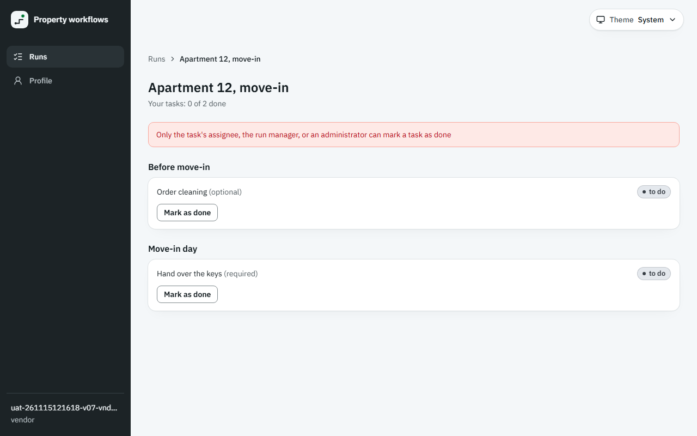

**Кроки:** ✔ Дано: the run "Apartment 12, move-in" in which task 1 is assigned to manager A and tasks 3 and 4 to vendor V → ✔ Коли: V tries to mark task 1 as done directly, bypassing the pages of the application → ✔ Тоді: task 1 stays "to do", and V gets the message "Only the task's assignee, the run manager, or an administrator can mark a task as done".

**Агент (claude-haiku-5-5, PASS):** На кадрі видно червоне повідомлення з текстом критерію, посимвольно збігається. Сторінка показує два завдання, обидва «to do», і лічильник «Your tasks: 0 of 2 done», що відповідає двом призначеним V задачам (3 і 4). На кадрі немає ідентифікаторів задач, тож відсутність задачі 1 виведена з кількості, а не з прямого напису.

**Цитати агента, звірені зі сторінкою (aria):**
- «Only the task's assignee, the run manager, or an administrator can mark a task as done» — є на сторінці
- «Your tasks: 0 of 2 done» — є на сторінці
- «Order cleaning (optional)» — є на сторінці
- «Hand over the keys (required)» — є на сторінці

**Правило:** R6: перевірки, агент і цитати збігаються

**Відео:** `test-results/artifacts/vendor-forbidden-AC-VENDOR-f562a-»-V-бачить-текст-AC-TASK-03-chromium/video.webm` · **траса:** `test-results/artifacts/vendor-forbidden-AC-VENDOR-f562a-»-V-бачить-текст-AC-TASK-03-chromium/trace.zip` (не в git)

**Рішення PM:** ☐ приймаю · ☐ відхилення від вимог (issue «Відхилення від вимог: AC-VENDOR-07 — …») · @login: ____

## AC-VENDOR-08 — PASS

**Тест:** AC-VENDOR-08: вендор V за прямим посиланням на список шаблонів бачить «Not enough rights», посилання «Back to runs» і жодного шаблону

**Критерій** (requirements/39-assign-a-vendor.md):

> AC-VENDOR-08: Given vendor V signed in. When V opens the list of templates by a direct link. Then V sees the message "Not enough rights" and the link "Back to runs", and no template.

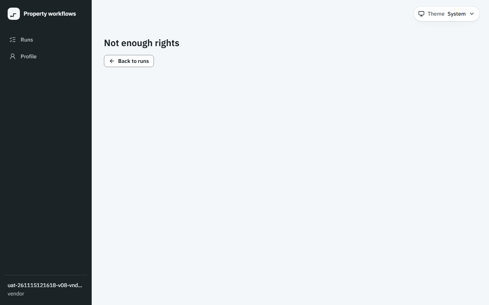

**Кроки:** ✔ Дано: vendor V signed in → ✔ Коли: V opens the list of templates by a direct link → ✔ Тоді: V sees the message "Not enough rights" and the link "Back to runs", and no template.

**Агент (claude-haiku-5-5, PASS):** На кадрі frame-then-1.png видно великий заголовок «Not enough rights» і кнопку зі стрілкою та написом «Back to runs» під ним. Таблиці шаблонів на кадрі немає, але це з розділу «Не з кадрів», тому не оцінюється.

**Цитати агента, звірені зі сторінкою (aria):**
- «Not enough rights» — є на сторінці
- «Back to runs» — є на сторінці

**Правило:** R6: перевірки, агент і цитати збігаються

**Відео:** `test-results/artifacts/vendor-forbidden-AC-VENDOR-28ad3--to-runs»-і-жодного-шаблону-chromium/video.webm` · **траса:** `test-results/artifacts/vendor-forbidden-AC-VENDOR-28ad3--to-runs»-і-жодного-шаблону-chromium/trace.zip` (не в git)

**Рішення PM:** ☐ приймаю · ☐ відхилення від вимог (issue «Відхилення від вимог: AC-VENDOR-08 — …») · @login: ____

## AC-VENDOR-09 — PASS

**Тест:** AC-VENDOR-09: вендор V прямим запитом, в обхід сторінок, запускає «Tenant move-in» — запуск не створено, список запусків не змінився

**Критерій** (requirements/39-assign-a-vendor.md):

> AC-VENDOR-09: Given vendor V signed in and the template "Tenant move-in" with current version 1. When V tries to launch this template directly, bypassing the pages of the application. Then no run is created, and the list of runs does not change.

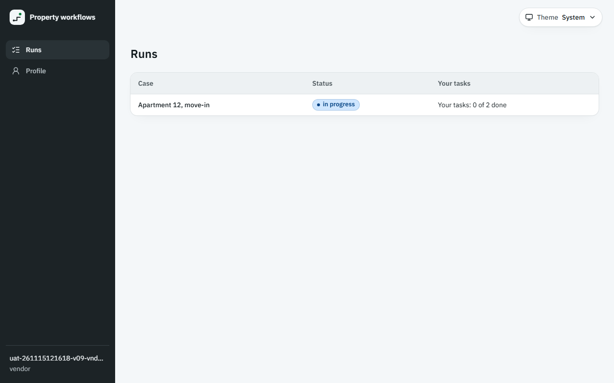

**Кроки:** ✔ Дано: vendor V signed in and the template "uat-261115121618-v09-tpl" (the tasks of "Tenant move-in") with current version 1 → ✔ Коли: V tries to launch this template directly, bypassing the pages of the application → ✔ Тоді: no run is created, and the list of runs does not change.

**Агент (claude-haiku-5-5, PASS):** На кадрі /runs видно рівно один рядок у таблиці: «Apartment 12, move-in», статус «in progress», «Your tasks: 0 of 2 done». Рядка «Apartment 16, move-in» немає, тож друга частина «Тоді» підтверджується відсутністю. Для цієї негативної частини цитатою взято єдиний видимий рядок, бо правило «текст відсутній — not-met» тут суперечило б самій перевірці відсутності.

**Цитати агента, звірені зі сторінкою (aria):**
- «Apartment 12, move-in» — є на сторінці
- «Your tasks: 0 of 2 done» — є на сторінці
- «Apartment 12, move-in» — є на сторінці

**Правило:** R6: перевірки, агент і цитати збігаються

**Відео:** `test-results/artifacts/vendor-forbidden-AC-VENDOR-01f35-список-запусків-не-змінився-chromium/video.webm` · **траса:** `test-results/artifacts/vendor-forbidden-AC-VENDOR-01f35-список-запусків-не-змінився-chromium/trace.zip` (не в git)

**Рішення PM:** ☐ приймаю · ☐ відхилення від вимог (issue «Відхилення від вимог: AC-VENDOR-09 — …») · @login: ____

## AC-VENDOR-10 — PASS

**Тест:** AC-VENDOR-10: вендор V, якому не призначено жодної задачі, відкриває список запусків і бачить «No tasks assigned to you yet.» без порожньої таблиці

**Критерій** (requirements/39-assign-a-vendor.md):

> AC-VENDOR-10: Given vendor V to whom no task is assigned. When V opens the list of runs. Then V sees the message "No tasks assigned to you yet." and no empty table.

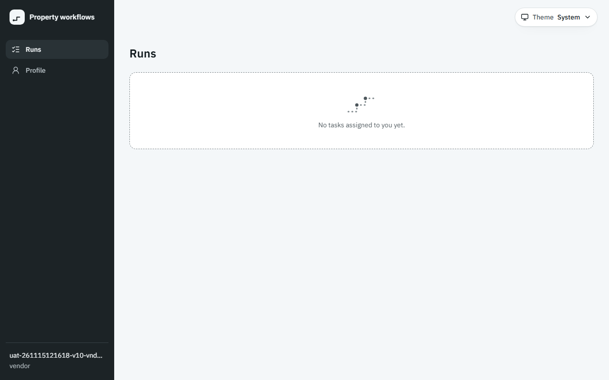

**Кроки:** ✔ Дано: vendor V to whom no task is assigned → ✔ Коли: V opens the list of runs → ✔ Тоді: V sees the message "No tasks assigned to you yet." and no empty table.

**Агент (claude-sonnet-5-5, PASS):** На сторінці «Runs» у пунктирній рамці видно текст «No tasks assigned to you yet.» з точним збігом до критерію. Таблиці на кадрі не видно, але ці частини за правилами не оцінювались.

Haiku сказав NEEDS-HUMAN, тож розбір повторив Sonnet; рішення агента — за Sonnet.

**Цитати агента, звірені зі сторінкою (aria):**
- «No tasks assigned to you yet.» — є на сторінці

**Правило:** R6: перевірки, агент і цитати збігаються

**Відео:** `test-results/artifacts/vendor-runs-AC-VENDOR-10-в-75084-yet-»-без-порожньої-таблиці-chromium/video.webm` · **траса:** `test-results/artifacts/vendor-runs-AC-VENDOR-10-в-75084-yet-»-без-порожньої-таблиці-chromium/trace.zip` (не в git)

**Рішення PM:** ☐ приймаю · ☐ відхилення від вимог (issue «Відхилення від вимог: AC-VENDOR-10 — …») · @login: ____

## AC-VENDOR-11 — PASS

**Тест:** AC-VENDOR-11: вендор V із задачами 3 («done») і 4 («to do») відкриває «Apartment 12, move-in» — заголовок сторінки — назва випадку, «Your tasks: 1 of 2 done», без статусу запуску, назви й версії шаблону

**Критерій** (requirements/39-assign-a-vendor.md):

> AC-VENDOR-11: Given vendor V who is the assignee of tasks 3 ("done") and 4 ("to do") in the run "Apartment 12, move-in" (5 tasks). When V opens this run. Then V sees the case name "Apartment 12, move-in" as the title of the page and "Your tasks: 1 of 2 done", and does not see the run status, the template name or the template version.

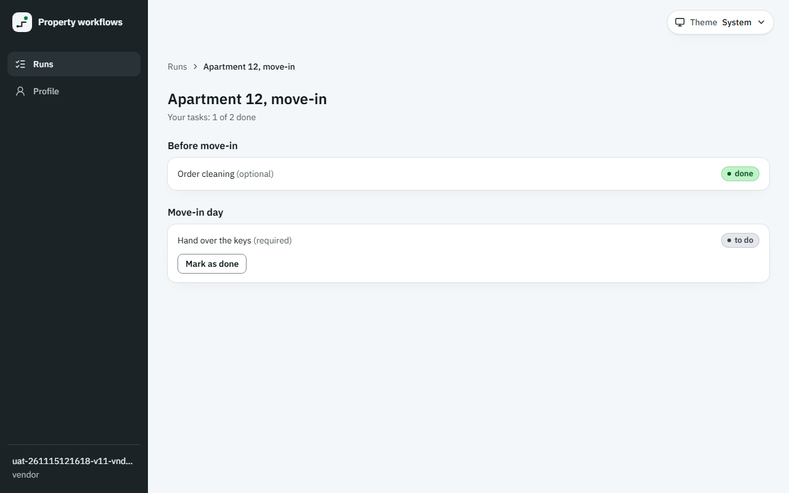

**Кроки:** ✔ Дано: vendor V who is the assignee of tasks 3 ("done") and 4 ("to do") in the run "Apartment 12, move-in" (5 tasks) → ✔ Коли: V opens this run → ✔ Тоді: V sees the case name "Apartment 12, move-in" as the title of the page and "Your tasks: 1 of 2 done", and does not see the run status, the template name or the template version.

**Агент (claude-haiku-5-5, PASS):** На кадрі frame-then-1.png видно h1 «Apartment 12, move-in» і підзаголовок «Your tasks: 1 of 2 done», обидва збігаються з критерієм посимвольно. Частини про відсутність статусу, назви шаблону та версії не оцінювались, бо вони з розділу «Не з кадрів»; на кадрі вони не суперечать критерію (є лише хлібні крихти «Runs > Apartment 12, move-in», картки «Before move-in» і «Move-in day»).

**Цитати агента, звірені зі сторінкою (aria):**
- «Apartment 12, move-in» — є на сторінці
- «Your tasks: 1 of 2 done» — є на сторінці

**Правило:** R6: перевірки, агент і цитати збігаються

**Відео:** `test-results/artifacts/vendor-runs-AC-VENDOR-11-в-96627-уску-назви-й-версії-шаблону-chromium/video.webm` · **траса:** `test-results/artifacts/vendor-runs-AC-VENDOR-11-в-96627-уску-назви-й-версії-шаблону-chromium/trace.zip` (не в git)

**Рішення PM:** ☐ приймаю · ☐ відхилення від вимог (issue «Відхилення від вимог: AC-VENDOR-11 — …») · @login: ____

## AC-VENDOR-12 — PASS

**Тест:** AC-VENDOR-12: вендор V відкриває список запусків — рядок «Apartment 12, move-in» показує назву випадку, статус запуску й «Your tasks: 0 of 2 done», без назви шаблону «Tenant move-in»

**Критерій** (requirements/39-assign-a-vendor.md):

> AC-VENDOR-12: Given vendor V who is the assignee of 2 tasks in the run "Apartment 12, move-in", launched from the template "Tenant move-in". When V opens the list of runs. Then the row of this run shows the case name, the run status and "Your tasks: 0 of 2 done", and does not show the template name "Tenant move-in".

**Кроки:** ✔ Дано: vendor V who is the assignee of 2 tasks in the run "Apartment 12, move-in", launched from the template "Tenant move-in" → ✔ Коли: V opens the list of runs → ✔ Тоді: the row of this run shows the case name, the run status and "Your tasks: 0 of 2 done", and does not show the template name "Tenant move-in".

**Агент (claude-haiku-5-5, PASS):** На кадрі сторінки Runs видно один рядок із випадком «Apartment 12, move-in», статусом «in progress» і написом «Your tasks: 0 of 2 done». Назви шаблону «Tenant move-in» і колонки «Template» на кадрі немає, але це перевіряють автоматичні перевірки, тож я їх не оцінював.

**Цитати агента, звірені зі сторінкою (aria):**
- «Apartment 12, move-in» — є на сторінці
- «in progress» — є на сторінці
- «Your tasks: 0 of 2 done» — є на сторінці

**Правило:** R6: перевірки, агент і цитати збігаються

**Відео:** `test-results/artifacts/vendor-runs-AC-VENDOR-12-в-7c4c2-ви-шаблону-«Tenant-move-in»-chromium/video.webm` · **траса:** `test-results/artifacts/vendor-runs-AC-VENDOR-12-в-7c4c2-ви-шаблону-«Tenant-move-in»-chromium/trace.zip` (не в git)

**Рішення PM:** ☐ приймаю · ☐ відхилення від вимог (issue «Відхилення від вимог: AC-VENDOR-12 — …») · @login: ____

## AC-VENDOR-13 — PASS

**Тест:** AC-VENDOR-13: вендор V входить — бачить список запусків, а навігація показує лише «Runs» і «Profile»

**Критерій** (requirements/39-assign-a-vendor.md):

> AC-VENDOR-13: Given vendor V who is the assignee of 2 tasks in the run "Apartment 12, move-in". When V signs in. Then V sees the list of runs, and the navigation shows only "Runs" and "Profile".

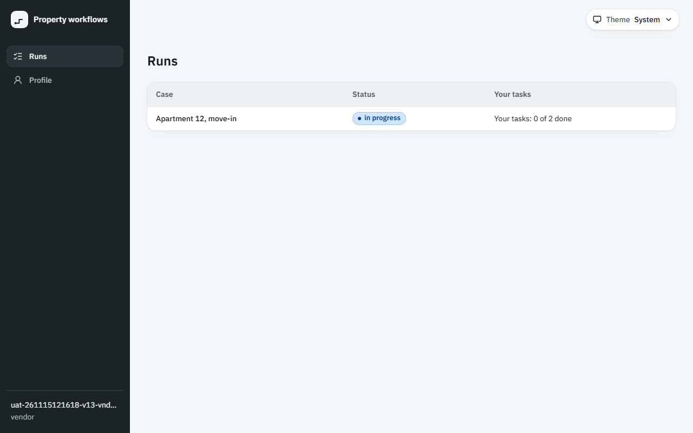

**Кроки:** ✔ Дано: vendor V who is the assignee of 2 tasks in the run "Apartment 12, move-in" → ✔ Коли: V signs in → ✔ Тоді: V sees the list of runs, and the navigation shows only "Runs" and "Profile".

**Агент (claude-haiku-5-5, PASS):** На кадрі видно сторінку «Runs» зі списком із одного запуску «Apartment 12, move-in» (статус in progress, «Your tasks: 0 of 2 done»). У лівій навігації два пункти — «Runs» і «Profile»; інших пунктів немає. Відсутність «Templates» не оцінювалася, бо за розділом це перевірка автоматики.

**Цитати агента, звірені зі сторінкою (aria):**
- «Runs» — є на сторінці
- «Apartment 12, move-in» — є на сторінці
- «Runs» — є на сторінці
- «Profile» — є на сторінці

**Правило:** R6: перевірки, агент і цитати збігаються

**Відео:** `test-results/artifacts/vendor-runs-AC-VENDOR-13-в-9311d-зує-лише-«Runs»-і-«Profile»-chromium/video.webm` · **траса:** `test-results/artifacts/vendor-runs-AC-VENDOR-13-в-9311d-зує-лише-«Runs»-і-«Profile»-chromium/trace.zip` (не в git)

**Рішення PM:** ☐ приймаю · ☐ відхилення від вимог (issue «Відхилення від вимог: AC-VENDOR-13 — …») · @login: ____

## AC-VENDOR-14 — PASS

**Тест:** AC-VENDOR-14: вендор V за прямим посиланням на форму запуску, сторінку шаблону, список версій і редактор бачить «Not enough rights» і «Back to runs», без вмісту шаблону

**Критерій** (requirements/39-assign-a-vendor.md):

> AC-VENDOR-14: Given vendor V signed in. When V opens the launch form, the page of a template, the list of versions or the editor by a direct link. Then V sees the message "Not enough rights" and the link "Back to runs", and no content of the template.

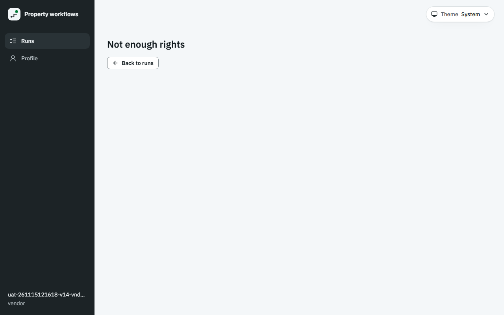

**Кроки:** ✔ Дано: vendor V signed in → ✔ Коли: V opens the launch form by a direct link → ✔ Тоді: V sees the message "Not enough rights" and the link "Back to runs", and no content of the template (the launch form). → ✔ Коли: V opens the page of a template by a direct link → ✔ Тоді: V sees the message "Not enough rights" and the link "Back to runs", and no content of the template (the page of a template). → ✔ Коли: V opens the list of versions by a direct link → ✔ Тоді: V sees the message "Not enough rights" and the link "Back to runs", and no content of the template (the list of versions). → ✔ Коли: V opens the editor by a direct link → ✔ Тоді: V sees the message "Not enough rights" and the link "Back to runs", and no content of the template (the editor).

**Агент (claude-haiku-5-5, PASS):** На всіх чотирьох кадрах (launch form, сторінка шаблону, список версій, редактор) видно однаковий екран: заголовок «Not enough rights» і кнопку «Back to runs», без форми, таблиці чи назви шаблону. Текст збігається з критерієм посимвольно. Адресу на кадрах не видно, тому куди веде посилання перевіряє тест, а не я.

**Цитати агента, звірені зі сторінкою (aria):**
- «Not enough rights» — є на сторінці
- «Back to runs» — є на сторінці
- «Not enough rights» — є на сторінці
- «Back to runs» — є на сторінці
- «Not enough rights» — є на сторінці
- «Back to runs» — є на сторінці
- «Not enough rights» — є на сторінці
- «Back to runs» — є на сторінці

**Правило:** R6: перевірки, агент і цитати збігаються

**Відео:** `test-results/artifacts/vendor-forbidden-AC-VENDOR-c5338-to-runs»-без-вмісту-шаблону-chromium/video.webm` · **траса:** `test-results/artifacts/vendor-forbidden-AC-VENDOR-c5338-to-runs»-без-вмісту-шаблону-chromium/trace.zip` (не в git)

**Рішення PM:** ☐ приймаю · ☐ відхилення від вимог (issue «Відхилення від вимог: AC-VENDOR-14 — …») · @login: ____

## AC-VENDOR-15 — PASS

**Тест:** AC-VENDOR-15: вендор V прямим запитом, в обхід сторінок, позначає задачу 1 менеджера A в «Apartment 14, repair», де в нього немає задач — задача 1 лишається «to do», V бачить лише «Run not found»

**Критерій** (requirements/39-assign-a-vendor.md):

> AC-VENDOR-15: Given the run "Apartment 14, repair" in which vendor V has no task and task 1 is assigned to manager A. When V tries to mark task 1 as done directly, bypassing the pages of the application. Then task 1 stays "to do", and V gets the message "Run not found".

**Кроки:** ✔ Дано: the run "Apartment 14, repair" in which vendor V has no task and task 1 is assigned to manager A → ✔ Коли: V tries to mark task 1 as done directly, bypassing the pages of the application → ✔ Тоді: task 1 stays "to do", and V gets the message "Run not found".

**Агент (claude-sonnet-5-5, PASS):** На кадрі сторінка з заголовком «Run not found» і кнопкою «Back to runs»; задач запуску та інших повідомлень немає. Бічна панель і профіль користувача (vendor) — звичайний інтерфейс.

Haiku сказав NEEDS-HUMAN, тож розбір повторив Sonnet; рішення агента — за Sonnet.

**Цитати агента, звірені зі сторінкою (aria):**
- «Run not found» — є на сторінці
- «Run not found» — є на сторінці
- «Back to runs» — є на сторінці

**Правило:** R6: перевірки, агент і цитати збігаються

**Відео:** `test-results/artifacts/vendor-forbidden-AC-VENDOR-85777-бачить-лише-«Run-not-found»-chromium/video.webm` · **траса:** `test-results/artifacts/vendor-forbidden-AC-VENDOR-85777-бачить-лише-«Run-not-found»-chromium/trace.zip` (не в git)

**Рішення PM:** ☐ приймаю · ☐ відхилення від вимог (issue «Відхилення від вимог: AC-VENDOR-15 — …») · @login: ____

## AC-VENDOR-16 — PASS

**Тест:** AC-VENDOR-16: вендор V позначає свою необов'язкову задачу 3 у «Apartment 12, move-in» зі статусом «completed» — «done», «Your tasks: 1 of 1 done», запуск лишається «completed»

**Критерій** (requirements/39-assign-a-vendor.md):

> AC-VENDOR-16: Given the run "Apartment 12, move-in" with status "completed" in which vendor V is the assignee of the optional task 3 with status "to do". When V marks task 3 as done. Then task 3 has status "done", V sees "Your tasks: 1 of 1 done", and the run stays "completed".

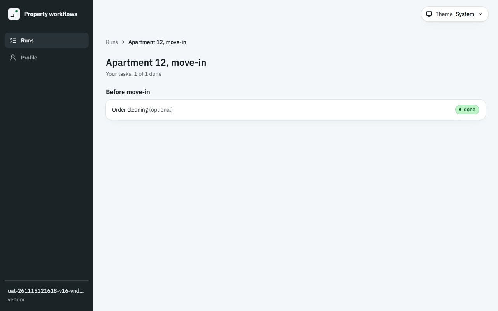
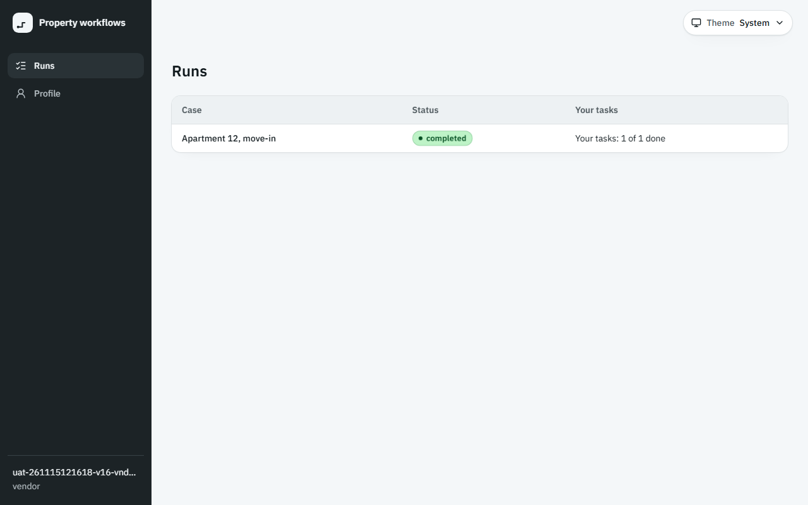

**Кроки:** ✔ Дано: the run "Apartment 12, move-in" with status "completed" in which vendor V is the assignee of the optional task 3 with status "to do" → ✔ Коли: V marks task 3 as done → ✔ Тоді: task 3 has status "done", V sees "Your tasks: 1 of 1 done", → ✔ Коли: V opens the list of runs → ✔ Тоді: and the run stays "completed".

**Агент (claude-haiku-5-5, PASS):** На frame-then-1.png сторінка запуску показує «Order cleaning (optional)» зі статусом «done» і напис «Your tasks: 1 of 1 done». На frame-then-2.png список запусків показує рядок «Apartment 12, move-in» зі статусом «completed» і «Your tasks: 1 of 1 done». Усі чотири видимі частини «Тоді» збігаються з критерієм посимвольно; частину про базу не оцінював, бо її немає на кадрах.

**Цитати агента, звірені зі сторінкою (aria):**
- «Order cleaning (optional)» — є на сторінці
- «done» — є на сторінці
- «Your tasks: 1 of 1 done» — є на сторінці
- «Apartment 12, move-in» — є на сторінці
- «completed» — є на сторінці
- «Your tasks: 1 of 1 done» — є на сторінці

**Правило:** R6: перевірки, агент і цитати збігаються

**Відео:** `test-results/artifacts/optional-after-completed-A-e6c2b-апуск-лишається-«completed»-chromium/video.webm` · **траса:** `test-results/artifacts/optional-after-completed-A-e6c2b-апуск-лишається-«completed»-chromium/trace.zip` (не в git)

**Рішення PM:** ☐ приймаю · ☐ відхилення від вимог (issue «Відхилення від вимог: AC-VENDOR-16 — …») · @login: ____

## AC-VENDOR-17 — PASS

**Тест:** AC-VENDOR-17: вендор V прямим запитом, в обхід сторінок, задач «Apartment 12, move-in» (5 задач) отримує лише задачі 3 і 4

**Критерій** (requirements/39-assign-a-vendor.md):

> AC-VENDOR-17: Given vendor V who is the assignee of tasks 3 and 4 in the run "Apartment 12, move-in" (5 tasks). When V requests the tasks of this run directly, bypassing the pages of the application. Then V receives only tasks 3 and 4.

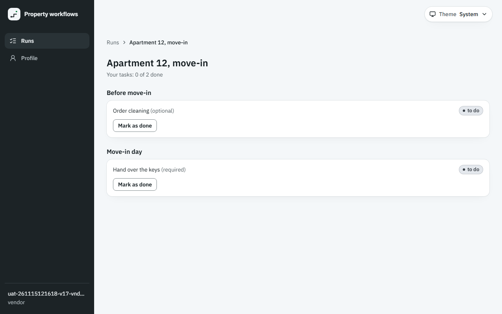

**Кроки:** ✔ Дано: vendor V who is the assignee of tasks 3 and 4 in the run "Apartment 12, move-in" (5 tasks) → ✔ Коли: V requests the tasks of this run directly, bypassing the pages of the application → ✔ Тоді: V receives only tasks 3 and 4.

**Агент (claude-haiku-5-5, PASS):** На кадрі сторінка «Apartment 12, move-in» з двома картками задач: «Order cleaning (optional)» у блоці «Before move-in» і «Hand over the keys (required)» у блоці «Move-in day». Лічильник «Your tasks: 0 of 2 done» узгоджується з двома задачами. Номери 3 і 4 на кадрі не видно, ідентифікація лише за назвами, що відповідає критерію.

**Цитати агента, звірені зі сторінкою (aria):**
- «Order cleaning (optional)» — є на сторінці
- «Hand over the keys (required)» — є на сторінці

**Правило:** R6: перевірки, агент і цитати збігаються

**Відео:** `test-results/artifacts/vendor-direct-reads-AC-VEN-7b450-ч-отримує-лише-задачі-3-і-4-chromium/video.webm` · **траса:** `test-results/artifacts/vendor-direct-reads-AC-VEN-7b450-ч-отримує-лише-задачі-3-і-4-chromium/trace.zip` (не в git)

**Рішення PM:** ☐ приймаю · ☐ відхилення від вимог (issue «Відхилення від вимог: AC-VENDOR-17 — …») · @login: ____

## AC-VENDOR-18 — PASS

**Тест:** AC-VENDOR-18: вендор V прямим запитом, в обхід сторінок, email і профілів інших користувачів і задач «Apartment 14, repair» не отримує нічого

**Критерій** (requirements/39-assign-a-vendor.md):

> AC-VENDOR-18: Given vendor V who is the assignee of tasks 3 and 4 in the run "Apartment 12, move-in" and of no task in the run "Apartment 14, repair". When V requests directly, bypassing the pages of the application, the emails and profiles of other users and the tasks of "Apartment 14, repair". Then V receives nothing about other users or about "Apartment 14, repair".

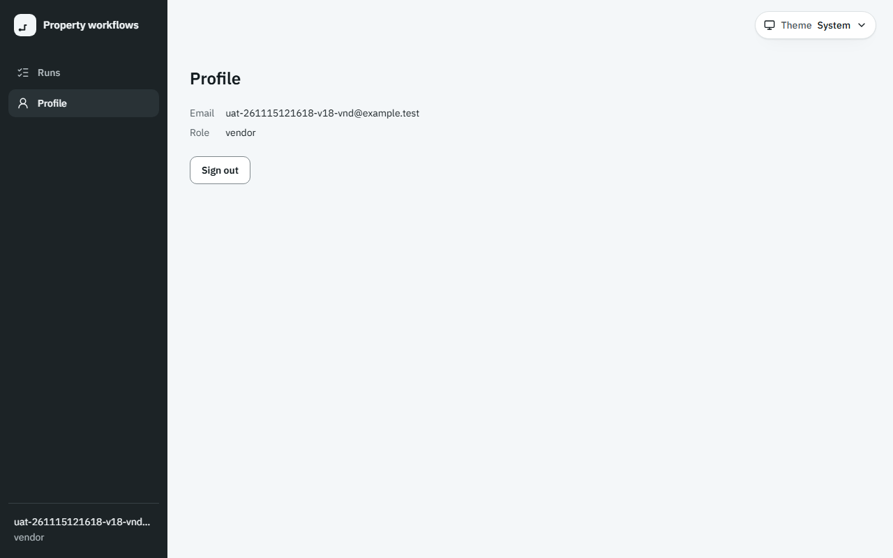

**Кроки:** ✔ Дано: vendor V who is the assignee of tasks 3 and 4 in the run "Apartment 12, move-in" and of no task in the run "Apartment 14, repair" → ✔ Коли: V requests directly, bypassing the pages of the application, the emails and profiles of other users and the tasks of "Apartment 14, repair" → ✔ Тоді: V receives nothing about other users → ✔ Коли: V opens the list of runs → ✔ Тоді: or about "Apartment 14, repair". → ✔ Коли: V opens the page of "Apartment 14, repair" by a direct link → ✔ Тоді: V receives nothing about "Apartment 14, repair" (the page of the run by a direct link).

**Агент (claude-haiku-5-5, PASS):** На кадрі 1 видно сторінку Profile з одним email (uat-261115121618-v18-vnd@example.test) і роль vendor; email A, B чи колег немає. На кадрі 2 список «Runs» містить єдиний рядок «Apartment 12, move-in» (in progress, 0 of 2 done), рядка «Apartment 14, repair» під ним немає, а простір нижче порожній. На кадрі 3 видно заголовок «Run not found» і кнопку «Back to runs». Адресної строки на кадрах не видно, тож URL сторінок «/» і «/runs/...» з кадрів не підтверджується; відсутність «Apartment 14, repair» на кадрі 2 — висновок з повного видимого списку. Для частини про відсутність рядка як цитату взято єдиний видимий рядок.

**Цитати агента, звірені зі сторінкою (aria):**
- «uat-261115121618-v18-vnd@example.test» — є на сторінці
- «Apartment 12, move-in» — є на сторінці
- «Apartment 12, move-in» — є на сторінці
- «Run not found» — є на сторінці

**Правило:** R6: перевірки, агент і цитати збігаються

**Відео:** `test-results/artifacts/vendor-direct-reads-AC-VEN-a5a71-4-repair»-не-отримує-нічого-chromium/video.webm` · **траса:** `test-results/artifacts/vendor-direct-reads-AC-VEN-a5a71-4-repair»-не-отримує-нічого-chromium/trace.zip` (не в git)

**Рішення PM:** ☐ приймаю · ☐ відхилення від вимог (issue «Відхилення від вимог: AC-VENDOR-18 — …») · @login: ____

## Як читати підсумок

- **PASS** — автоматичні перевірки пройшли, агент-рецензент погодився з кадром, а кожну його цитату знайдено на сторінці.
- **FAIL** — впала автоматична перевірка. Агент цього не перекриває: невидимі вади (буфер обміну, база) він на кадрі не побачить.
- **NEEDS-HUMAN** — перевірки зелені, але агент не погодився або його цитати немає на сторінці. Часто це слабкий тест або розбіжність між текстом AC і тестом — питання до PM, а не обов'язково вада продукту.

Правила: R1: перевірка впала — FAIL завжди, агент не перекриває; R2: немає вердикту агента або кадру; R3: перевірки пройшли, агент не погоджується — вирішує людина; R4: цитати агента немає на сторінці (aria) — не підтверджено; R5: помилка сторінки або 5xx під час сценарію; R6: перевірки, агент і цитати збігаються.
