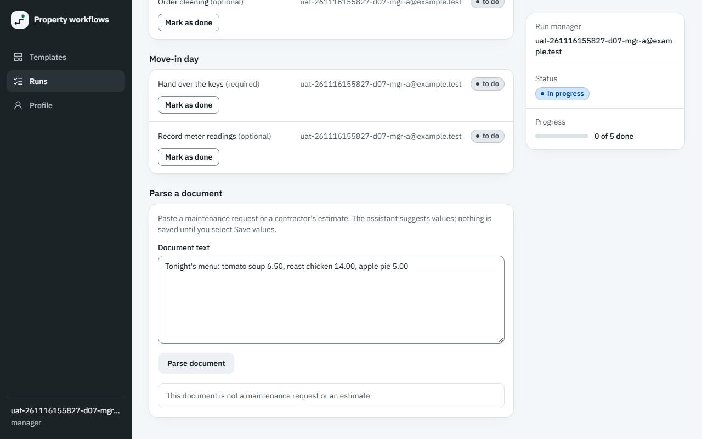
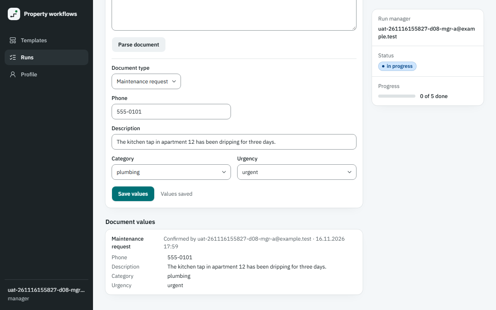

# Звіт UAT — 16.11.2026

- **Застосунок:** https://property-workflows-eta.vercel.app (/api/health: коміт `304a5c9`)
- **Код тестів:** `task/docai-uat` @ `1ff38c8` + незакомічені зміни
- **Прогін:** 16.11.2026, 17:58 (Київ), Playwright 66.9 с; AC: 2 — PASS 2, FAIL 0, NEEDS-HUMAN 0
- **Рецензент:** `claude-haiku-5-5`; суперечки → `claude-sonnet-5-5`. Разом за розбір: $0.0352 (ціни API; за підпискою — у межах ліміту плану)
- **Прибирання:** синтетичних uat-*@example.test видалено 2, лишилось 0, їхніх рядків, що лишились: 0
- **Відео й траси:** не в git — `test-results/` локально або артефакт CI; трасу відкриває `npx playwright show-trace <trace.zip>`

| AC | Перевірки | Агент | Підсумок | Чому | Playwright | Розбір |
|---|---|---|---|---|---|---|
| AC-DOCAI-07 | пройшли | Haiku: PASS | **PASS** | R6: перевірки, агент і цитати збігаються | 20.3 с | $0.0020, 12.3 с |
| AC-DOCAI-08 | пройшли | Haiku: PASS, Sonnet: PASS | **PASS** | R6: перевірки, агент і цитати збігаються | 26.2 с | $0.0332, 19.3 с |

## AC-DOCAI-07 — PASS

**Тест:** AC-DOCAI-07: менеджер запуску вставляє меню (golden case 9) — повідомлення «This document is not a maintenance request or an estimate.», жодних значень

**Критерій** (openspec/specs/document-parsing/spec.md):

> AC-DOCAI-07 — Меню замість звернення
> - GIVEN менеджер запуску A і текст «Tonight's menu: tomato soup 6.50, roast chicken 14.00, apple pie 5.00» (golden case 9)
> - WHEN A вставляє текст у запуску і просить його розібрати
> - THEN A бачить повідомлення «This document is not a maintenance request or an estimate.»
> - AND жодних значень не запропоновано

**Кроки:** ✔ Дано: the run manager A and the text "Tonight's menu: tomato soup 6.50, roast chicken 14.00, apple pie 5.00" (golden case 9) → ✔ Коли: A pastes the text in the run and asks to parse it → ✔ Тоді: A sees the message "This document is not a maintenance request or an estimate." and no values are proposed.

**Агент (claude-haiku-5-5, PASS):** На кадрі блок «Parse a document» містить введений текст меню, кнопку «Parse document» і одне повідомлення «This document is not a maintenance request or an estimate.», після якого блок закінчується. Кнопки «Save values» і жодних полів значень на кадрі немає, а під карткою видно лише порожній фон. Текст повідомлення збігається з критерієм посимвольно.

**Цитати агента, звірені зі сторінкою (aria):**
- «This document is not a maintenance request or an estimate.» — є на сторінці
- «This document is not a maintenance request or an estimate.» — є на сторінці
- «Parse a document» — є на сторінці

**Правило:** R6: перевірки, агент і цитати збігаються

**Відео:** `test-results/artifacts/document-parsing-AC-DOCAI--79c97-n-estimate-»-жодних-значень-chromium/video.webm` · **траса:** `test-results/artifacts/document-parsing-AC-DOCAI--79c97-n-estimate-»-жодних-значень-chromium/trace.zip` (не в git)

**Рішення PM:** ☐ приймаю · ☐ відхилення від вимог (issue «Відхилення від вимог: AC-DOCAI-07 — …») · @login: ____

## AC-DOCAI-08 — PASS

**Тест:** AC-DOCAI-08: менеджер запуску змінює urgency пропозиції golden case 1 на «urgent» і підтверджує — збережені значення з «urgent», до підтвердження нічого не збережено

**Критерій** (openspec/specs/document-parsing/spec.md):

> AC-DOCAI-08 — Користувач виправляє і підтверджує пропозицію
> - GIVEN менеджер запуску A бачить пропозицію з golden case 1, і в запуску ще немає збережених значень
> - WHEN A змінює urgency на «urgent» і підтверджує
> - THEN на сторінці запуску показано збережені значення з urgency «urgent»
> - AND доки A не підтвердив, у запуску не було збережених значень

**Кроки:** ✔ Дано: the run manager A sees the proposal for golden case 1, and the run has no saved values yet → ✔ Коли: A changes urgency to "urgent" and confirms → ✔ Тоді: the run page shows the saved values with urgency "urgent".

**Агент (claude-sonnet-5-5, PASS):** На кадрі є розділ «Document values» із записом «Maintenance request», Phone 555-0101 та Urgency urgent. Рядок «Confirmed by» містить email менеджера A і час 16.11.2026 17:59. Частини «Не з кадрів» не оцінювались.

Haiku сказав PASS, тож розбір повторив Sonnet; рішення агента — за Sonnet.

**Цитати агента, звірені зі сторінкою (aria):**
- «Document values» — є на сторінці
- «Maintenance request» — є на сторінці
- «Phone» — є на сторінці
- «555-0101» — є на сторінці
- «Urgency» — є на сторінці
- «urgent» — є на сторінці
- «Confirmed by uat-261116155827-d08-mgr-a@example.test · 16.11.2026 17:59» — є на сторінці

**Правило:** R6: перевірки, агент і цитати збігаються

**Відео:** `test-results/artifacts/document-parsing-AC-DOCAI--d2375-рдження-нічого-не-збережено-chromium/video.webm` · **траса:** `test-results/artifacts/document-parsing-AC-DOCAI--d2375-рдження-нічого-не-збережено-chromium/trace.zip` (не в git)

**Рішення PM:** ☐ приймаю · ☐ відхилення від вимог (issue «Відхилення від вимог: AC-DOCAI-08 — …») · @login: ____

## Як читати підсумок

- **PASS** — автоматичні перевірки пройшли, агент-рецензент погодився з кадром, а кожну його цитату знайдено на сторінці.
- **FAIL** — впала автоматична перевірка. Агент цього не перекриває: невидимі вади (буфер обміну, база) він на кадрі не побачить.
- **NEEDS-HUMAN** — перевірки зелені, але агент не погодився або його цитати немає на сторінці. Часто це слабкий тест або розбіжність між текстом AC і тестом — питання до PM, а не обов'язково вада продукту.

Правила: R1: перевірка впала — FAIL завжди, агент не перекриває; R2: немає вердикту агента або кадру; R3: перевірки пройшли, агент не погоджується — вирішує людина; R4: цитати агента немає на сторінці (aria) — не підтверджено; R5: помилка сторінки або 5xx під час сценарію; R6: перевірки, агент і цитати збігаються.
