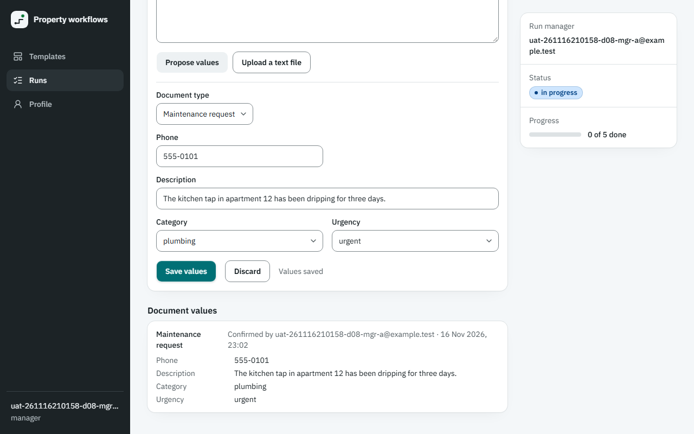
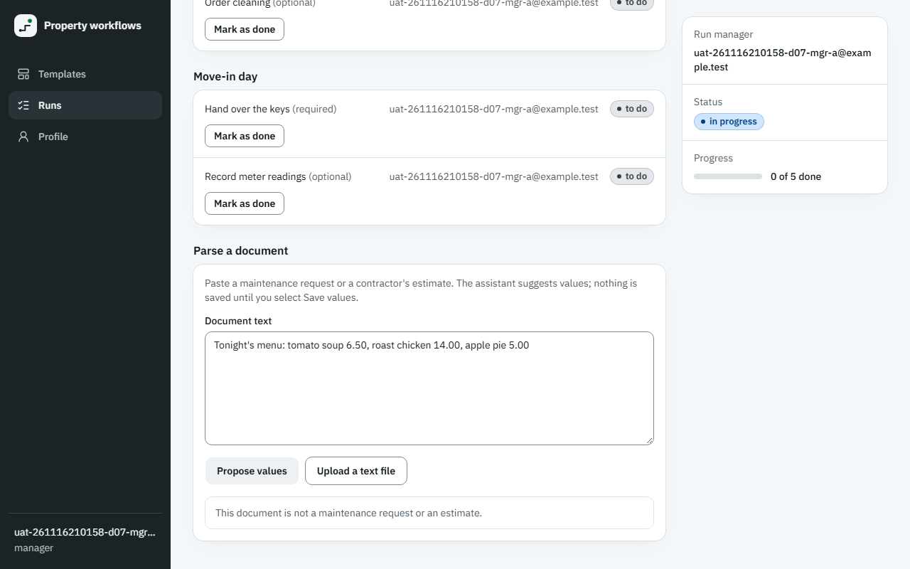

# Звіт UAT — 16.11.2026

- **Застосунок:** https://property-workflows-eta.vercel.app (/api/health: коміт `3dd27f8`)
- **Код тестів:** `main` @ `3dd27f8`
- **Прогін:** 16.11.2026, 23:01 (Київ), Playwright 72.3 с; AC: 2 — PASS 2, FAIL 0, NEEDS-HUMAN 0
- **Рецензент:** `claude-haiku-5-5`; суперечки → `claude-sonnet-5-5`. Разом за розбір: $0.0459 (ціни API; за підпискою — у межах ліміту плану)
- **Прибирання:** синтетичних uat-*@example.test видалено 2, лишилось 0, їхніх рядків, що лишились: 0
- **Відео й траси:** не в git — `test-results/` локально або артефакт CI; трасу відкриває `npx playwright show-trace <trace.zip>`

| AC | Перевірки | Агент | Підсумок | Чому | Playwright | Розбір |
|---|---|---|---|---|---|---|
| AC-DOCAI-04 | пройшли | Haiku: PASS, Sonnet: PASS | **PASS** | R6: перевірки, агент і цитати збігаються | 28.9 с | $0.0435, 23.6 с |
| AC-DOCAI-09 | пройшли | Haiku: PASS | **PASS** | R6: перевірки, агент і цитати збігаються | 22.7 с | $0.0024, 10.5 с |

## AC-DOCAI-04 — PASS

**Тест:** AC-DOCAI-04: менеджер запуску змінює Urgency пропозиції на «urgent» і обирає «Save values» — один запис з «urgent», email і часом

**Критерій** (requirements/59-parse-a-document-and-confirm.md):

> AC-DOCAI-04: Given run manager A with Document type "Maintenance request", Phone "555-0101", Category "plumbing" and Urgency "not urgent" proposed in the block. When A changes Urgency to "urgent" and chooses "Save values". Then the page of the run shows one saved record with Document type "Maintenance request", Phone "555-0101", Category "plumbing" and Urgency "urgent", the email of A and the date and time of the confirmation.

**Кроки:** ✔ Дано: run manager A with Document type "Maintenance request", Phone "555-0101", Category "plumbing" and Urgency "not urgent" proposed in the block → ✔ Коли: A changes Urgency to "urgent" and chooses "Save values" → ✔ Тоді: the page of the run shows one saved record with Document type "Maintenance request", Phone "555-0101", Category "plumbing" and Urgency "urgent", the email of A and the date and time of the confirmation.

**Агент (claude-sonnet-5-5, PASS):** У розділі «Document values» видно один запис «Maintenance request» з Phone 555-0101, Category plumbing, Urgency urgent. Підтвердження показано як «Confirmed by uat-261116210158-d08-mgr-a@example.test · 16 Nov 2026, 23:02». Email збігається з менеджером запуску справа. Частини «Не з кадрів» не оцінювались.

Haiku сказав PASS, тож розбір повторив Sonnet; рішення агента — за Sonnet.

**Цитати агента, звірені зі сторінкою (aria):**
- «Document values» — є на сторінці
- «Maintenance request» — є на сторінці
- «Phone» — є на сторінці
- «555-0101» — є на сторінці
- «Category» — є на сторінці
- «plumbing» — є на сторінці
- «Urgency» — є на сторінці
- «urgent» — є на сторінці
- «Confirmed by uat-261116210158-d08-mgr-a@example.test · 16 Nov 2026, 23:02» — є на сторінці

**Правило:** R6: перевірки, агент і цитати збігаються

**Відео:** `test-results/artifacts/document-parsing-AC-DOCAI--3d82d-ис-з-«urgent»-email-і-часом-chromium/video.webm` · **траса:** `test-results/artifacts/document-parsing-AC-DOCAI--3d82d-ис-з-«urgent»-email-і-часом-chromium/trace.zip` (не в git)

**Рішення PM:** ☐ приймаю · ☐ відхилення від вимог (issue «Відхилення від вимог: AC-DOCAI-04 — …») · @login: ____

## AC-DOCAI-09 — PASS

**Тест:** AC-DOCAI-09: менеджер запуску вставляє меню й обирає «Propose values» — «This document is not a maintenance request or an estimate.», жодного значення

**Критерій** (requirements/59-parse-a-document-and-confirm.md):

> AC-DOCAI-09: Given run manager A and the pasted text "Tonight's menu: tomato soup 6.50, roast chicken 14.00, apple pie 5.00". When A chooses "Propose values". Then the block shows "This document is not a maintenance request or an estimate." and no value is proposed.

**Кроки:** ✔ Дано: run manager A and the pasted text "Tonight's menu: tomato soup 6.50, roast chicken 14.00, apple pie 5.00" → ✔ Коли: A chooses "Propose values" → ✔ Тоді: the block shows "This document is not a maintenance request or an estimate." and no value is proposed.

**Агент (claude-haiku-5-5, PASS):** На кадрі в блоці «Parse a document» видно текст «This document is not a maintenance request or an estimate.», який збігається з критерієм посимвольно. Під цим повідомленням картка закінчується, кнопки «Save values» і форми значень немає, а під карткою лише порожнє тло. Поле з текстом меню і кнопка «Propose values» на кадрі присутні, тому запуск дійшов до потрібного кроку.

**Цитати агента, звірені зі сторінкою (aria):**
- «This document is not a maintenance request or an estimate.» — є на сторінці
- «This document is not a maintenance request or an estimate.» — є на сторінці
- «Parse a document» — є на сторінці

**Правило:** R6: перевірки, агент і цитати збігаються

**Відео:** `test-results/artifacts/document-parsing-AC-DOCAI--2f03a-estimate-»-жодного-значення-chromium/video.webm` · **траса:** `test-results/artifacts/document-parsing-AC-DOCAI--2f03a-estimate-»-жодного-значення-chromium/trace.zip` (не в git)

**Рішення PM:** ☐ приймаю · ☐ відхилення від вимог (issue «Відхилення від вимог: AC-DOCAI-09 — …») · @login: ____

## Як читати підсумок

- **PASS** — автоматичні перевірки пройшли, агент-рецензент погодився з кадром, а кожну його цитату знайдено на сторінці.
- **FAIL** — впала автоматична перевірка. Агент цього не перекриває: невидимі вади (буфер обміну, база) він на кадрі не побачить.
- **NEEDS-HUMAN** — перевірки зелені, але агент не погодився або його цитати немає на сторінці. Часто це слабкий тест або розбіжність між текстом AC і тестом — питання до PM, а не обов'язково вада продукту.

Правила: R1: перевірка впала — FAIL завжди, агент не перекриває; R2: немає вердикту агента або кадру; R3: перевірки пройшли, агент не погоджується — вирішує людина; R4: цитати агента немає на сторінці (aria) — не підтверджено; R5: помилка сторінки або 5xx під час сценарію; R6: перевірки, агент і цитати збігаються.
